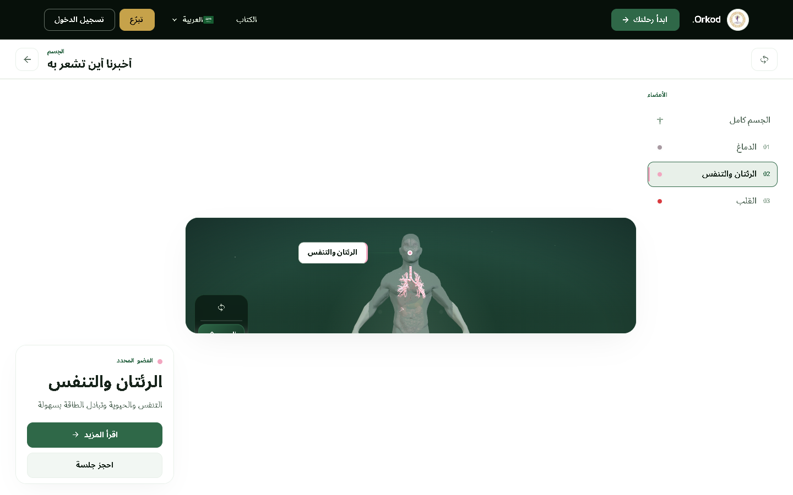
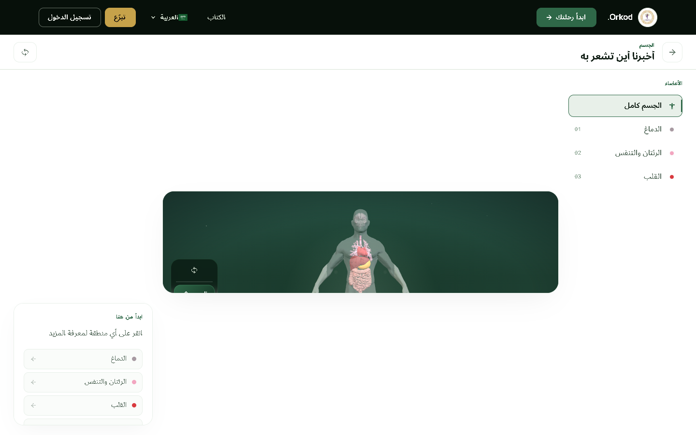
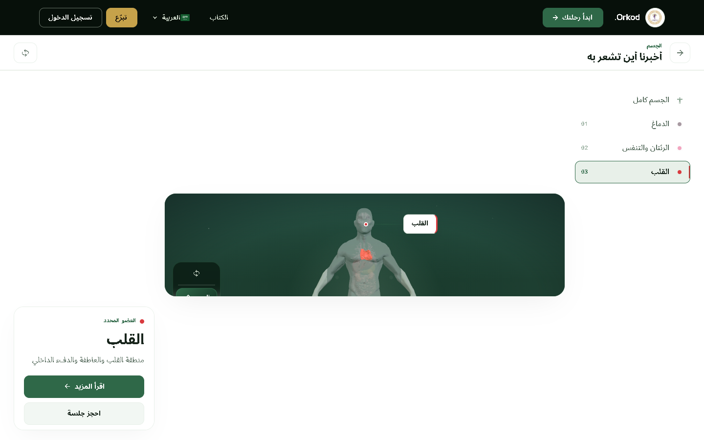
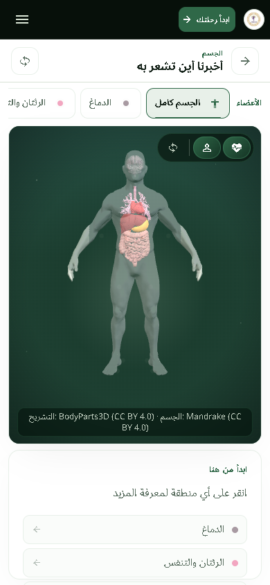
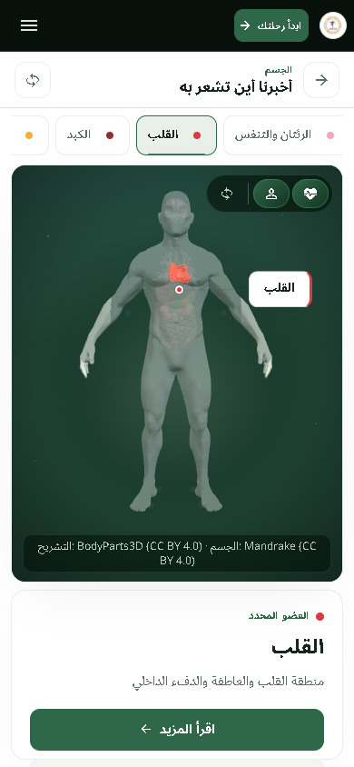
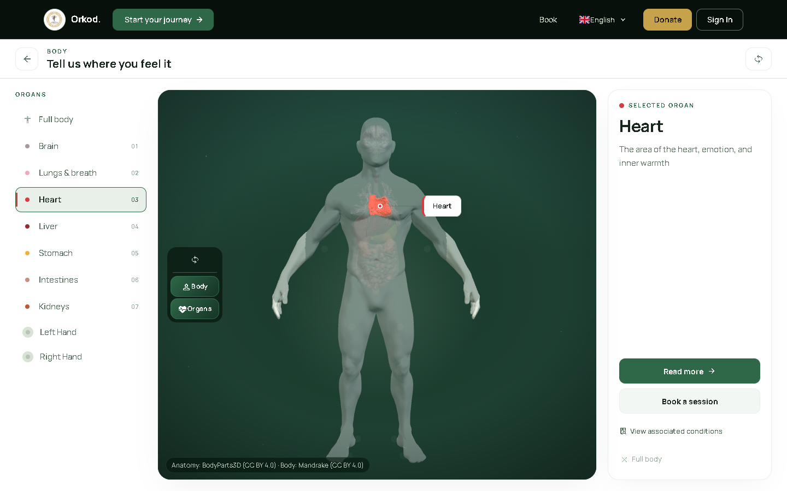

# ORKOD Final Product Audit — 2026-11-07

## Project audit summary
- **Project:** ORKOD / PranaHealing (`rezoroyone-dev/pranichealing`)
- **Application branch:** `nature-green-final`
- **Exact application commit (accepted fix):** `85b9304` — `fix(body): align Arabic Body Explorer header and arrows for RTL`
- **Review evidence package (this directory):** `final-product-audit-2026-11-07/` — screenshots only (85 PNG files). No application source, secrets, env files, credentials, or `node_modules` included.
- **Locales/screens captured:** English (`en`) and Arabic (`ar`, RTL) via headless Chromium (SwiftShader). Viewports: `1440×900`, `768×1024`, `390×844`, `360×800` where available per route.

## Arabic Body Explorer fix (P0, accepted)
**Issue (confirmed in AR browser audit):** Arabic Body Explorer UI chrome had LTR layout leakage — header/anatomy navigator/selector/labels resolved direction/start leftward in computed styles; decorative Latin letter-spacing on eyebrow/label; hardcoded LTR directional icons for back/read-more/list arrows. 3D anatomical canvas was physically preserved (no mirroring).

**Fix (app `85b9304`, `frontend/src/views/public/BodyExplorer3D.vue` only):** set `:dir="textDirection"` on header and anatomy navigator; `text-align:start` for header/selector labels; removed RTL letter-spacing for eyebrow/label; direction-aware arrows (`mdi-arrow-right/left` ↔ `mdi-arrow-left/right` by `rtl`). Organ data, hand colors, callouts, and 3D stage/canvas unchanged.

**Verification (AR):** header/title/label/selector/detail `direction:rtl`; back icon `mdi-arrow-right`; organ/hand clicks update detail/callout; no horizontal overflow at 1440×900/768×1024/390×844/360×800; canvas transforms `none` (anatomy physically LTR, never mirrored). EN regression checked (heart selection).

### Before / after (Body Explorer)
| View | Image |
|---|---|
| AR before/diagnosis check (1440×900) |  |
| AR before/diagnosis check (viewport 5) |  |
| AR **after** fix (1440×900) |  |
| AR **after** + Heart selected (1440×900) |  |
| AR **after** fix (390×844) |  |
| AR **after** + Heart selected (390×844) |  |
| EN regression + Heart selected (1440×900) |  |

## P0 / P1 / P2 / P3 findings
| Priority | Finding | Status | Evidence |
|---|---|---|---|
| **P0** | Arabic Body Explorer header/nav/selector/labels/icons showed LTR direction leakage; 3D anatomy must remain physically LTR. | **Fixed & accepted** (app `85b9304`) | [Body Explorer after](./body-explorer/) |
| **P1** | Home hero typography/hierarchy density (desktop/mobile, EN/AR) — page-purpose polish. | Identified, not changed in this pass | [en-home-1440](./all-pages/en-home-1440x900.png), [ar-home-1440](./all-pages/ar-home-1440x900.png), [en-home-390](./all-pages/en-home-390x844.png), [ar-home-390](./all-pages/ar-home-390x844.png) |
| **P1** | Quiz progression/selection reassurance clarity. | Identified, not changed | [en-quiz](./all-pages/en-quiz-1440x900.png), [ar-quiz](./all-pages/ar-quiz-1440x900.png) |
| **P2** | Practitioners/Doctors sparse/premium presentation (no invented data). | Identified, not changed | [en-practitioners](./all-pages/en-practitioners-1440x900.png), [ar-practitioners](./all-pages/ar-practitioners-1440x900.png), [en-doctors](./all-pages/en-doctors-1440x900.png), [ar-doctors](./all-pages/ar-doctors-1440x900.png) |
| **P2** | Cross-page completion/shell consistency; Conditions scannability. | Identified, not changed | [all-pages](./all-pages/) |
| **P3** | Donations/Booking/Consultations trust/step cues (preserve auth gates/data integrity). | Identified, not changed | [en-donations](./all-pages/en-donations-1440x900.png), [ar-donations](./all-pages/ar-donations-1440x900.png), [en-booking](./all-pages/en-booking-1440x900.png), [ar-booking](./all-pages/ar-booking-1440x900.png) |

## Desktop / mobile comparisons (key pages)
| Page | EN 1440×900 | EN 390×844 | AR 1440×900 | AR 390×844 |
|---|---|---|---|---|
| Language gate | [en](./all-pages/en-language-gate-1440x900.png) | [en](./all-pages/en-language-gate-390x844.png) | [ar](./all-pages/ar-language-gate-1440x900.png) | [ar](./all-pages/ar-language-gate-390x844.png) |
| Home | [en](./all-pages/en-home-1440x900.png) | [en](./all-pages/en-home-390x844.png) | [ar](./all-pages/ar-home-1440x900.png) | [ar](./all-pages/ar-home-390x844.png) |
| Start | [en](./all-pages/en-start-1440x900.png) | [en](./all-pages/en-start-390x844.png) | [ar](./all-pages/ar-start-1440x900.png) | [ar](./all-pages/ar-start-390x844.png) |
| Body | [en](./all-pages/en-body-1440x900.png) | [en](./all-pages/en-body-390x844.png) | [ar](./all-pages/ar-body-1440x900.png) | [ar](./all-pages/ar-body-390x844.png) |
| Conditions | [en](./all-pages/en-conditions-1440x900.png) | [en](./all-pages/en-conditions-390x844.png) | [ar](./all-pages/ar-conditions-1440x900.png) | [ar](./all-pages/ar-conditions-390x844.png) |
| Quiz | [en](./all-pages/en-quiz-1440x900.png) | — | [ar](./all-pages/ar-quiz-1440x900.png) | [ar](./all-pages/ar-quiz-390x844.png) |
| Booking | [en](./all-pages/en-booking-1440x900.png) | — | [ar](./all-pages/ar-booking-1440x900.png) | [ar](./all-pages/ar-booking-390x844.png) |
| Donations | [en](./all-pages/en-donations-1440x900.png) | — | [ar](./all-pages/ar-donations-1440x900.png) | [ar](./all-pages/ar-donations-390x844.png) |

## EN / AR comparisons (1440×900)
| Page | EN | AR |
|---|---|---|
| Academy | [en](./all-pages/en-academy-1440x900.png) | [ar](./all-pages/ar-academy-1440x900.png) |
| Assistant | [en](./all-pages/en-assistant-1440x900.png) | [ar](./all-pages/ar-assistant-1440x900.png) |
| Body | [en](./all-pages/en-body-1440x900.png) | [ar](./all-pages/ar-body-1440x900.png) |
| Booking | [en](./all-pages/en-booking-1440x900.png) | [ar](./all-pages/ar-booking-1440x900.png) |
| Community | [en](./all-pages/en-community-1440x900.png) | [ar](./all-pages/ar-community-1440x900.png) |
| Conditions | [en](./all-pages/en-conditions-1440x900.png) | [ar](./all-pages/ar-conditions-1440x900.png) |
| Consultations | [en](./all-pages/en-consultations-1440x900.png) | [ar](./all-pages/ar-consultations-1440x900.png) |
| Contact | [en](./all-pages/en-contact-1440x900.png) | [ar](./all-pages/ar-contact-1440x900.png) |
| Doctors | [en](./all-pages/en-doctors-1440x900.png) | [ar](./all-pages/ar-doctors-1440x900.png) |
| Donations | [en](./all-pages/en-donations-1440x900.png) | [ar](./all-pages/ar-donations-1440x900.png) |
| Family | [en](./all-pages/en-family-1440x900.png) | [ar](./all-pages/ar-family-1440x900.png) |
| Home | [en](./all-pages/en-home-1440x900.png) | [ar](./all-pages/ar-home-1440x900.png) |
| Language gate | [en](./all-pages/en-language-gate-1440x900.png) | [ar](./all-pages/ar-language-gate-1440x900.png) |
| Practitioners | [en](./all-pages/en-practitioners-1440x900.png) | [ar](./all-pages/ar-practitioners-1440x900.png) |
| Quiz | [en](./all-pages/en-quiz-1440x900.png) | [ar](./all-pages/ar-quiz-1440x900.png) |
| Start | [en](./all-pages/en-start-1440x900.png) | [ar](./all-pages/ar-start-1440x900.png) |

## All available JSON evidence
- **In this package:** none (this audit package contains screenshot evidence only; no JSON files were generated as part of the `final-product-audit-2026-11-07` capture set).
- Application verification outputs (run in app repo at `85b9304`): `vue-tsc --noEmit` pass; `vite build` pass; safe unit suite pass (see Test results).

## Test results (application `85b9304`)
| Check | Result |
|---|---|
| `npx eslint src/views/public/BodyExplorer3D.vue` | **Pass** |
| `npm run typecheck` / `vue-tsc --noEmit` | **Pass** |
| Safe unit suite (9 files) | **Pass — 9 files, 91 tests** (`i18n.parity`, `home.presentation`, `body-architecture`, `BodyExplorer.interaction`, `a11y.public`, `PublicFeatures.integrity`, `locale.persistence`, `features`, `Router.unit`) |
| `npx vite build` | **Pass** |
| Repo-wide `npx eslint .` | **Fail** on unrelated pre-existing generated/build artifact/legacy debt (not caused by fix); reported honestly |

## File inventory (actual)
- `body-explorer/`: `ar-body-after-1440x900.png`, `ar-body-after-390x844.png`, `ar-body-after-heart-1440x900.png`, `ar-body-after-heart-390x844.png`, `ar-check-1.png`, `ar-check-5.png`, `en-body-heart-after-1440.png`
- `all-pages/`: 78 PNG captures (EN/AR, 1440×900 / 768×1024 / 390×844 / 360×800 where captured). Filenames listed by directory contents: all files matching `./all-pages/*.png` in this package.
- `main-pages/`: present in package directory if captured; see folder contents (may be empty in this minimal evidence set).
