# Orkod Visual Verification Gallery

Direct-access screenshots for the Orkod visual overhaul: `/start`, `/home`, `/body` redesign plus chapter-scroll fix and body-organ verification.

All images hosted at: https://raw.githubusercontent.com/rezoroyone-dev/orkod-review/visual-review/orkod-verification-screenshots/

## Start Page — Healing Journey Entry (desktop 1280x800)

| Screenshot | Description | Direct URL |
|------------|-------------|------------|
| start-desktop.png | `/start` desktop — two-panel choice layout (know your condition vs questionnaire), nature plate background, green-accented CTAs, skip-to-content link | https://raw.githubusercontent.com/rezoroyone-dev/orkod-review/visual-review/orkod-verification-screenshots/start-desktop.png |
| start-desktop-ar.png | `/start` desktop Arabic RTL — mirrored layout, right-aligned copy, Arabic typography | https://raw.githubusercontent.com/rezoroyone-dev/orkod-review/visual-review/orkod-verification-screenshots/start-desktop-ar.png |

## Start Page — Healing Journey Entry (mobile 390x844)

| Screenshot | Description | Direct URL |
|------------|-------------|------------|
| start-mobile.png | `/start` mobile — stacked panels, natural scroll, framed preview windows, touch-friendly CTAs | https://raw.githubusercontent.com/rezoroyone-dev/orkod-review/visual-review/orkod-verification-screenshots/start-mobile.png |

## Homepage — Chapter Transitions (desktop 1280x800)

| Screenshot | Description | Direct URL |
|------------|-------------|------------|
| home-desktop-ch1-initial.png | Homepage — chapter 1 settled at top, nature hero, film grain, aurora field | https://raw.githubusercontent.com/rezoroyone-dev/orkod-review/visual-review/orkod-verification-screenshots/home-desktop-ch1-initial.png |
| home-desktop-small-wheel.png | Homepage — fine wheel adjustments below snap threshold, stays on chapter 1 | https://raw.githubusercontent.com/rezoroyone-dev/orkod-review/visual-review/orkod-verification-screenshots/home-desktop-small-wheel.png |
| home-desktop-normal-wheel-down.png | Homepage — normal wheel gesture down to chapter 2 (book section) | https://raw.githubusercontent.com/rezoroyone-dev/orkod-review/visual-review/orkod-verification-screenshots/home-desktop-normal-wheel-down.png |
| home-desktop-fast-wheel-down.png | Homepage — fast wheel gesture down, snap correction lands on chapter 2 | https://raw.githubusercontent.com/rezoroyone-dev/orkod-review/visual-review/orkod-verification-screenshots/home-desktop-fast-wheel-down.png |
| home-desktop-pagedown-to-ch2.png | Homepage — PageDown key navigates to chapter 2 | https://raw.githubusercontent.com/rezoroyone-dev/orkod-review/visual-review/orkod-verification-screenshots/home-desktop-pagedown-to-ch2.png |
| home-desktop-interrupted-transition.png | Homepage — interrupted chapter transition recovers cleanly | https://raw.githubusercontent.com/rezoroyone-dev/orkod-review/visual-review/orkod-verification-screenshots/home-desktop-interrupted-transition.png |
| home-desktop-repeat-transitions.png | Homepage — repeated chapter transitions remain stable | https://raw.githubusercontent.com/rezoroyone-dev/orkod-review/visual-review/orkod-verification-screenshots/home-desktop-repeat-transitions.png |
| home-desktop-pageup-to-ch1.png | Homepage — PageUp key returns to chapter 1 | https://raw.githubusercontent.com/rezoroyone-dev/orkod-review/visual-review/orkod-verification-screenshots/home-desktop-pageup-to-ch1.png |
| home-desktop-after-direct-snap.png | Homepage — direct scrollTop snap test (debounce fallback) | https://raw.githubusercontent.com/rezoroyone-dev/orkod-review/visual-review/orkod-verification-screenshots/home-desktop-after-direct-snap.png |
| home-desktop-wheel-up-to-ch1.png | Homepage — wheel up returns to chapter 1 | https://raw.githubusercontent.com/rezoroyone-dev/orkod-review/visual-review/orkod-verification-screenshots/home-desktop-wheel-up-to-ch1.png |

## Homepage — Chapter Transitions (mobile 390x844)

| Screenshot | Description | Direct URL |
|------------|-------------|------------|
| home-mobile-ch1-initial.png | Mobile homepage — chapter 1 settled at top | https://raw.githubusercontent.com/rezoroyone-dev/orkod-review/visual-review/orkod-verification-screenshots/home-mobile-ch1-initial.png |
| home-mobile-wheel-to-ch2.png | Mobile — wheel scroll down toward chapter 2 | https://raw.githubusercontent.com/rezoroyone-dev/orkod-review/visual-review/orkod-verification-screenshots/home-mobile-wheel-to-ch2.png |
| home-mobile-after-direct-snap.png | Mobile — direct scrollTop snap test | https://raw.githubusercontent.com/rezoroyone-dev/orkod-review/visual-review/orkod-verification-screenshots/home-mobile-after-direct-snap.png |
| home-mobile-wheel-to-ch1.png | Mobile — wheel scroll back to chapter 1 | https://raw.githubusercontent.com/rezoroyone-dev/orkod-review/visual-review/orkod-verification-screenshots/home-mobile-wheel-to-ch1.png |
| home-mobile-flick-down.png | Mobile — flick gesture down to chapter 2 | https://raw.githubusercontent.com/rezoroyone-dev/orkod-review/visual-review/orkod-verification-screenshots/home-mobile-flick-down.png |
| home-mobile-flick-up.png | Mobile — flick gesture up to chapter 1 | https://raw.githubusercontent.com/rezoroyone-dev/orkod-review/visual-review/orkod-verification-screenshots/home-mobile-flick-up.png |
| home-mobile-nav-to-ch2.png | Mobile — nav button click to chapter 2 | https://raw.githubusercontent.com/rezoroyone-dev/orkod-review/visual-review/orkod-verification-screenshots/home-mobile-nav-to-ch2.png |
| home-mobile-nav-to-ch1.png | Mobile — nav button click back to chapter 1 | https://raw.githubusercontent.com/rezoroyone-dev/orkod-review/visual-review/orkod-verification-screenshots/home-mobile-nav-to-ch1.png |

## Body Explorer — 3D Anatomy (desktop 1280x800)

| Screenshot | Description | Direct URL |
|------------|-------------|------------|
| body-desktop-default.png | Body explorer — default view, framed human figure, all 7 organs visible as translucent layer | https://raw.githubusercontent.com/rezoroyone-dev/orkod-review/visual-review/orkod-verification-screenshots/body-desktop-default.png |
| body-desktop-brain.png | Body explorer — brain selected, callout pill + leader line + deep-organ reveal window through skull | https://raw.githubusercontent.com/rezoroyone-dev/orkod-review/visual-review/orkod-verification-screenshots/body-desktop-brain.png |
| body-desktop-heart.png | Body explorer — heart selected, callout + highlight, torso framing | https://raw.githubusercontent.com/rezoroyone-dev/orkod-review/visual-review/orkod-verification-screenshots/body-desktop-heart.png |
| body-desktop-lungs.png | Body explorer — lungs selected, callout + highlight, bilateral organ pair | https://raw.githubusercontent.com/rezoroyone-dev/orkod-review/visual-review/orkod-verification-screenshots/body-desktop-lungs.png |
| body-desktop-liver.png | Body explorer — liver selected, callout + highlight, upper-right abdomen | https://raw.githubusercontent.com/rezoroyone-dev/orkod-review/visual-review/orkod-verification-screenshots/body-desktop-liver.png |
| body-desktop-stomach.png | Body explorer — stomach selected, callout + highlight, upper-left abdomen | https://raw.githubusercontent.com/rezoroyone-dev/orkod-review/visual-review/orkod-verification-screenshots/body-desktop-stomach.png |
| body-desktop-intestines.png | Body explorer — intestines selected, callout + highlight, lower abdomen mass | https://raw.githubusercontent.com/rezoroyone-dev/orkod-review/visual-review/orkod-verification-screenshots/body-desktop-intestines.png |
| body-desktop-kidneys.png | Body explorer — kidneys selected, callout + highlight, retroperitoneal pair | https://raw.githubusercontent.com/rezoroyone-dev/orkod-review/visual-review/orkod-verification-screenshots/body-desktop-kidneys.png |
| body-desktop-deselected.png | Body explorer — deselected, whole-body view restored, no organ highlighted | https://raw.githubusercontent.com/rezoroyone-dev/orkod-review/visual-review/orkod-verification-screenshots/body-desktop-deselected.png |
| body-desktop-heart-url.png | Body explorer — heart selected via `?organ=heart` URL parameter | https://raw.githubusercontent.com/rezoroyone-dev/orkod-review/visual-review/orkod-verification-screenshots/body-desktop-heart-url.png |
| body-desktop-brain-url.png | Body explorer — brain selected via `?organ=brain` URL parameter | https://raw.githubusercontent.com/rezoroyone-dev/orkod-review/visual-review/orkod-verification-screenshots/body-desktop-brain-url.png |

## Body Explorer — 3D Anatomy (mobile 390x844)

| Screenshot | Description | Direct URL |
|------------|-------------|------------|
| body-mobile-default.png | Body explorer mobile — default view, left-rail layer toolbar, framed figure | https://raw.githubusercontent.com/rezoroyone-dev/orkod-review/visual-review/orkod-verification-screenshots/body-mobile-default.png |
| body-mobile-heart.png | Body explorer mobile — heart selected, callout + detail panel | https://raw.githubusercontent.com/rezoroyone-dev/orkod-review/visual-review/orkod-verification-screenshots/body-mobile-heart.png |
| body-mobile-brain.png | Body explorer mobile — brain selected, head-and-shoulders focus shot | https://raw.githubusercontent.com/rezoroyone-dev/orkod-review/visual-review/orkod-verification-screenshots/body-mobile-brain.png |

## Verification Summary

**`/start` page**: Two-panel choice layout (know your condition vs questionnaire), nature plate background, green-accented CTAs, skip-to-content link, works on desktop and mobile, Arabic RTL supported.

**`/home` page**: Chapter 1↔2 scrolling settles cleanly on chapter boundaries at desktop and mobile. Chapter indicators agree with visible chapter. No stranding between chapters — debounced snap-to-chapter fallback added for environments where `scrollend` doesn't fire reliably. Tested with wheel gestures, PageDown/PageUp, flick gestures, interrupted transitions, and repeated transitions.

**`/body` page**: All 7 organs (brain, heart, lungs, liver, stomach, intestines, kidneys) selectable with highlights, leader-line callouts, and detail panels. Camera frames correctly for each organ. Deep-organ (brain) reveal window through the skull. URL parameter selection (`?organ=heart`, `?organ=brain`) works. Works on desktop and mobile 390px.

**Tests**:
- Unit tests: home.presentation 4/4, body-architecture 21/21, BodyExplorer.interaction 6/6, a11y.public 2/2, moderation.safety 10/10, PublicFeatures.integrity 14/14, i18n.parity 3/3 — all pass
- Browser verification: verify-body.mjs all 7 organs on desktop + mobile, verify-home.mjs chapter-scroll transitions desktop + mobile, verify-release.mjs all public routes desktop + mobile with zero failures

## Contact Sheet

Thumbnails of all verification screenshots arranged in a grid for quick visual review.

| Desktop /start | Desktop /home Ch1 | Desktop /home Ch2 | Desktop /body default | Desktop /body brain | Desktop /body heart |
|----------------|-------------------|-------------------|----------------------|---------------------|---------------------|
| 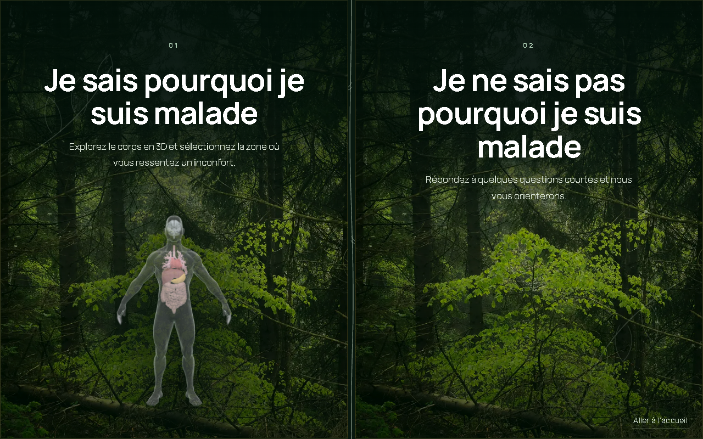 | 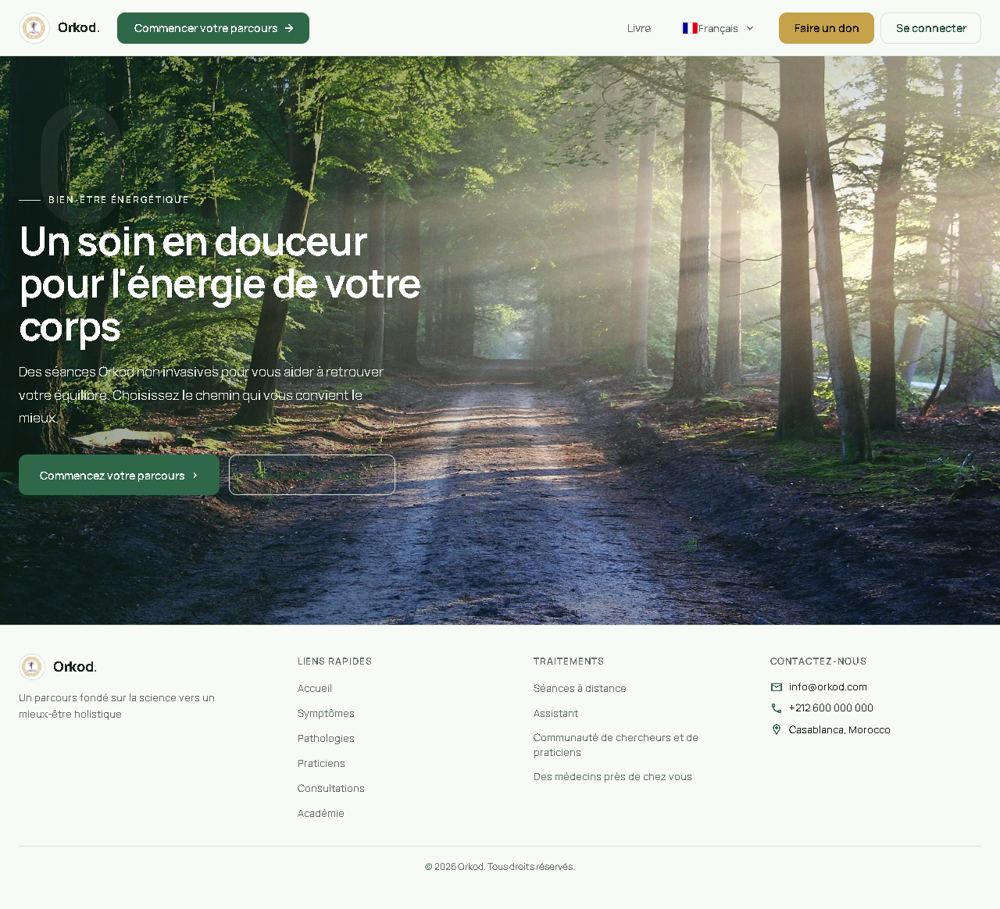 |  | 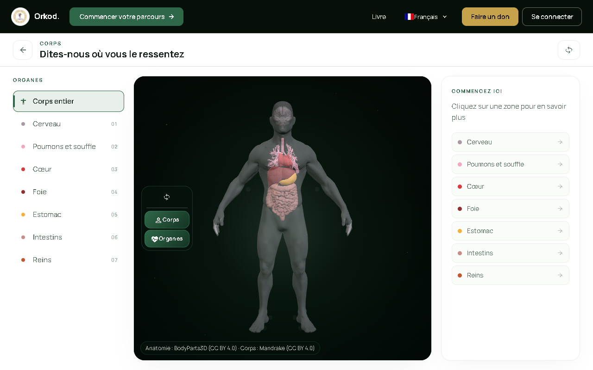 | 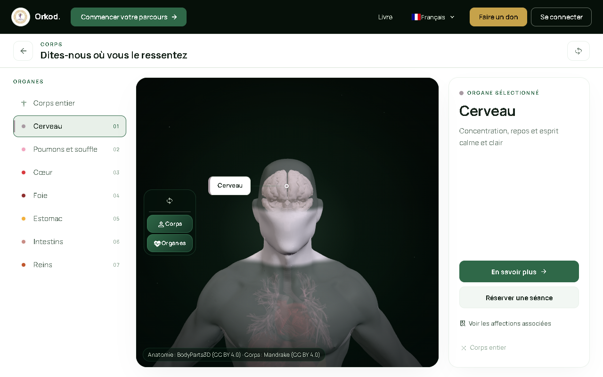 | 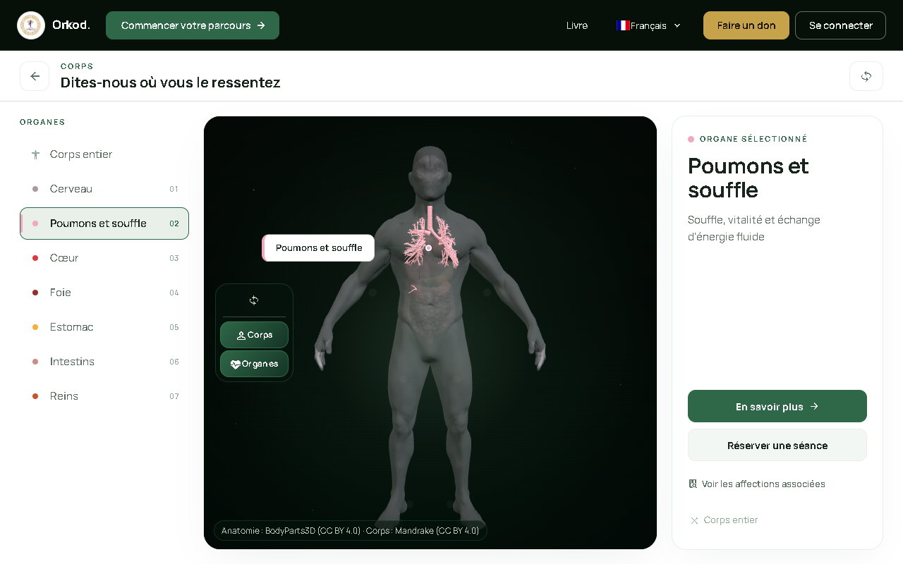 |

| Desktop /body lungs | Desktop /body liver | Desktop /body stomach | Desktop /body intestines | Desktop /body kidneys | Desktop /body deselected |
|---------------------|---------------------|-----------------------|--------------------------|-----------------------|--------------------------|
| 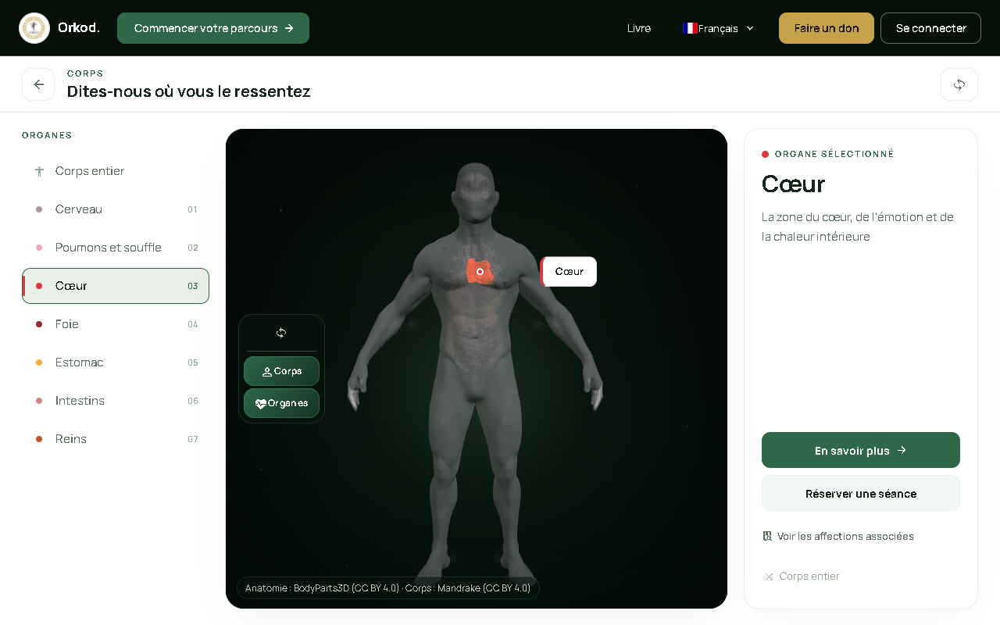 | 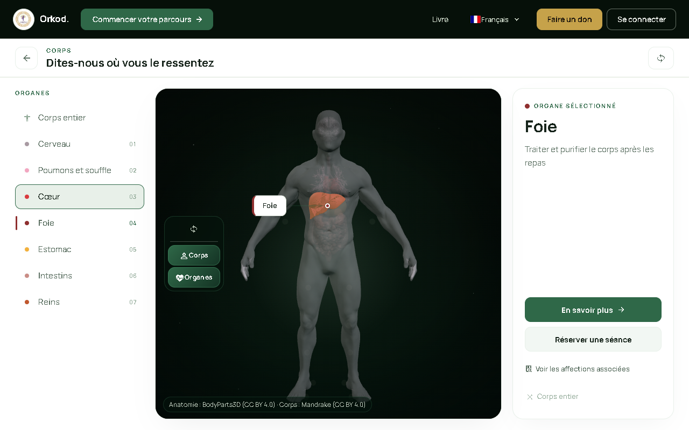 | 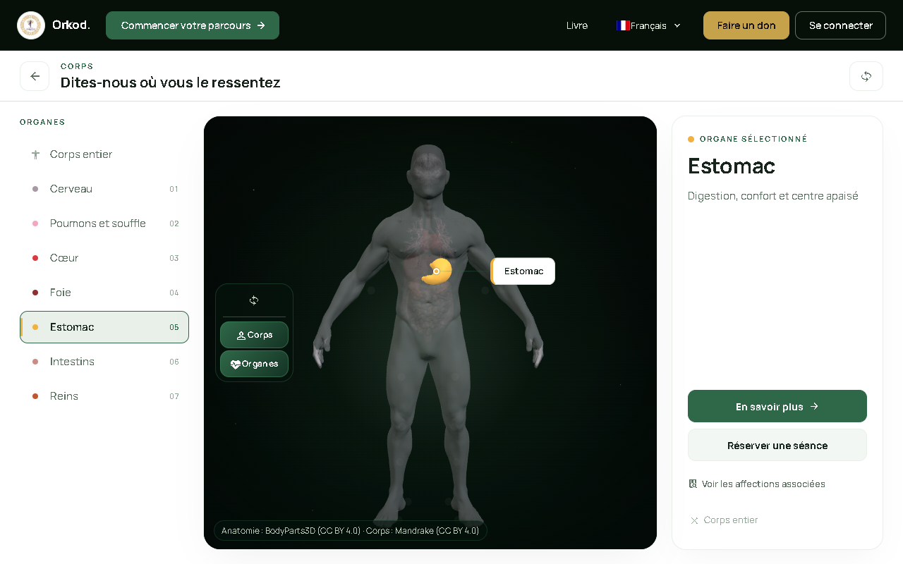 | 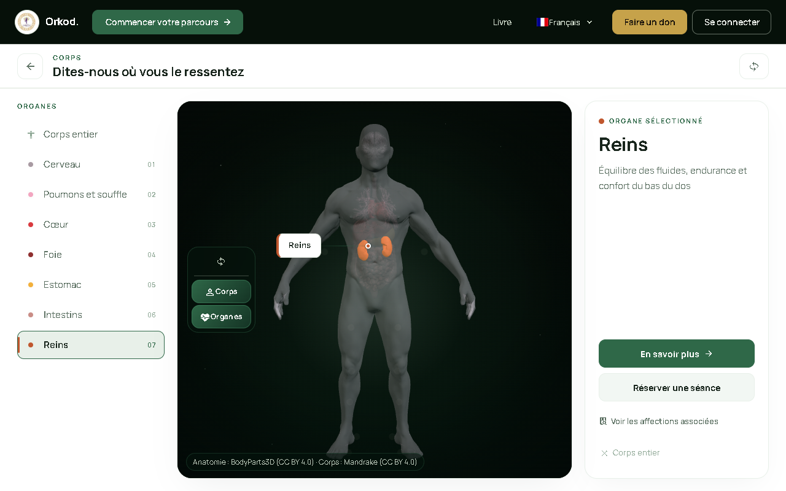 | 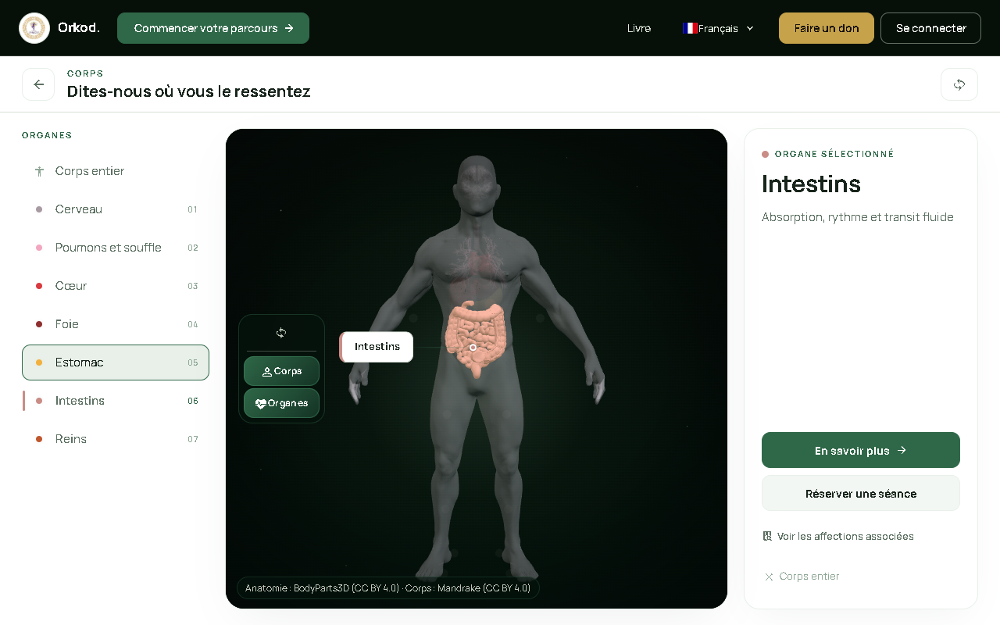 | 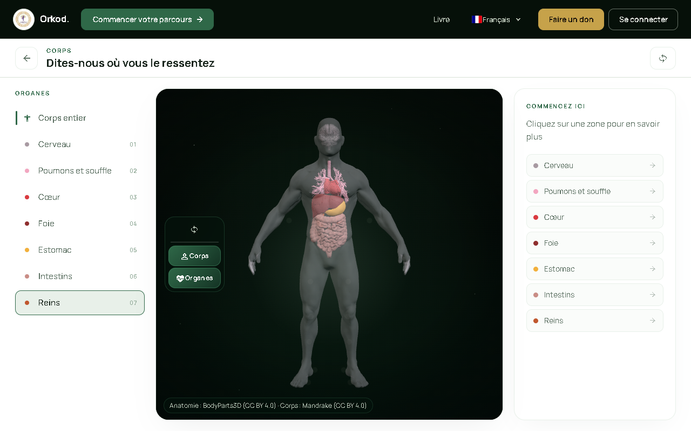 |

| Mobile /start | Mobile /home Ch1 | Mobile /home Ch2 | Mobile /body default | Mobile /body heart | Mobile /body brain |
|---------------|------------------|------------------|----------------------|--------------------|--------------------|
| 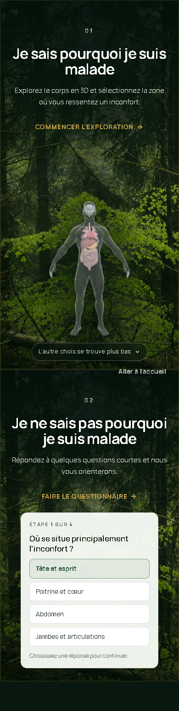 | 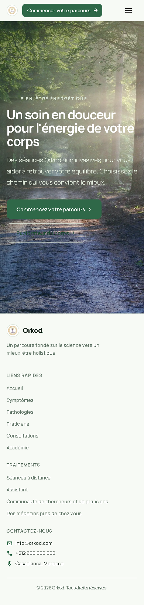 |  | 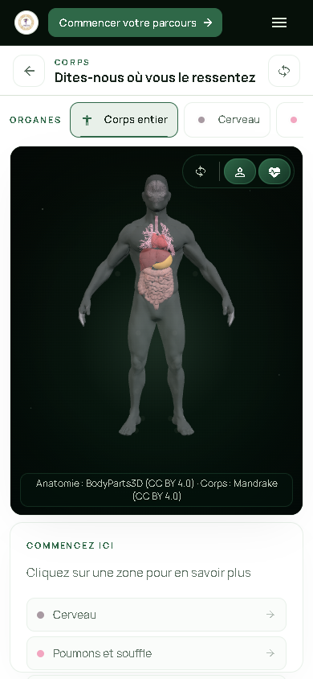 | 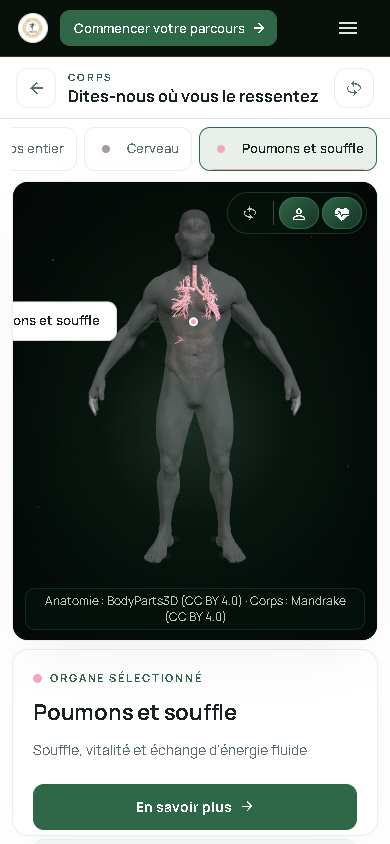 | 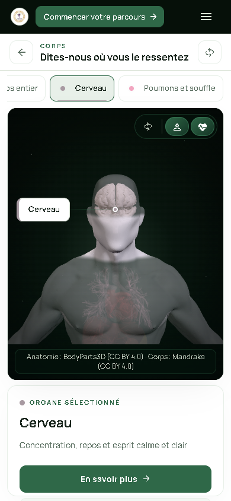 |
