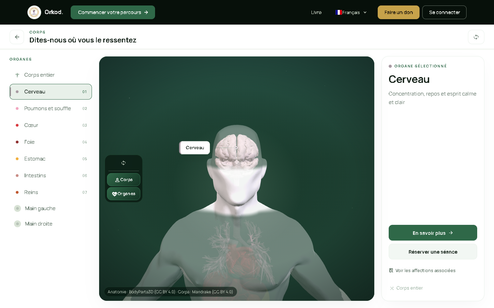
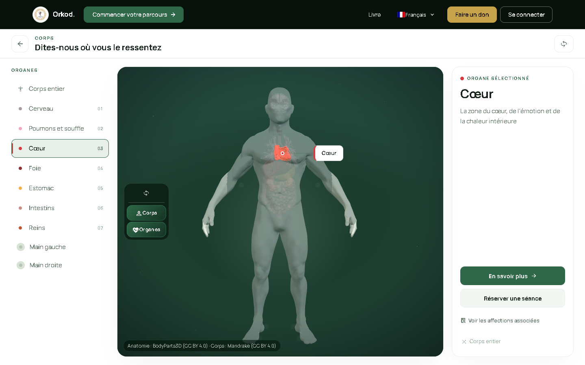
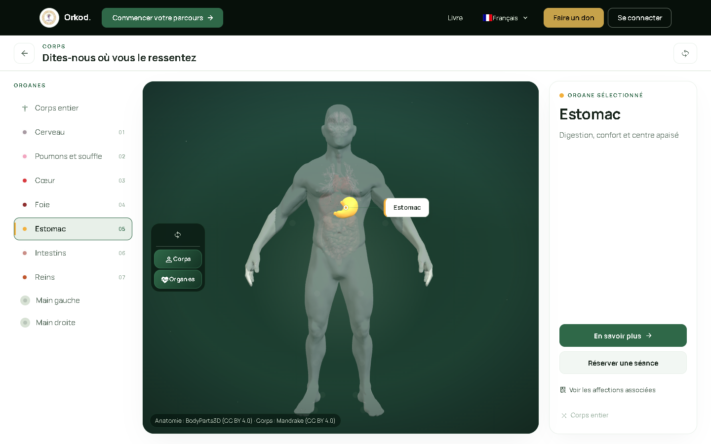
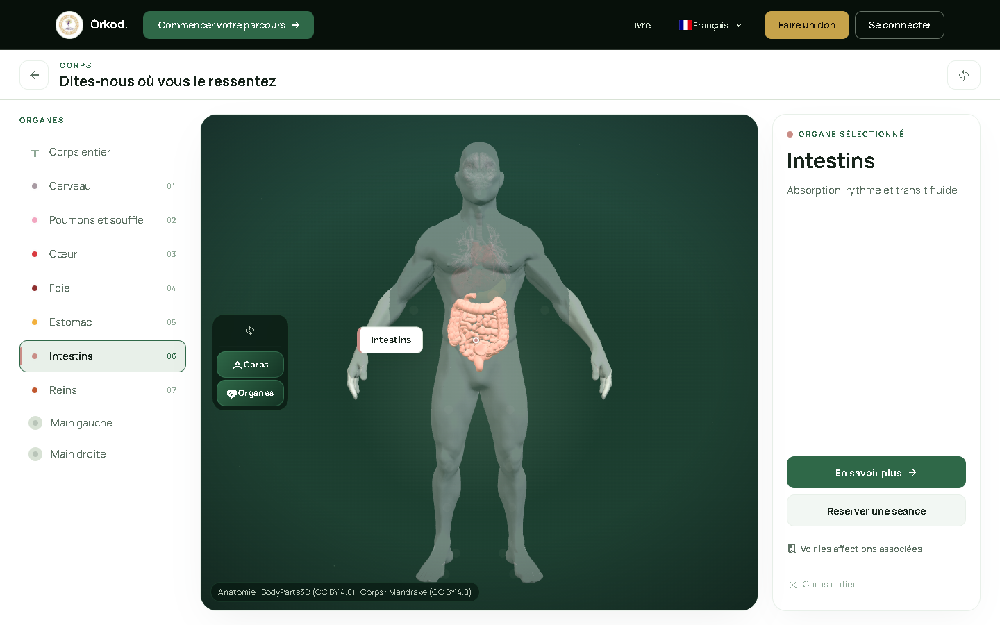
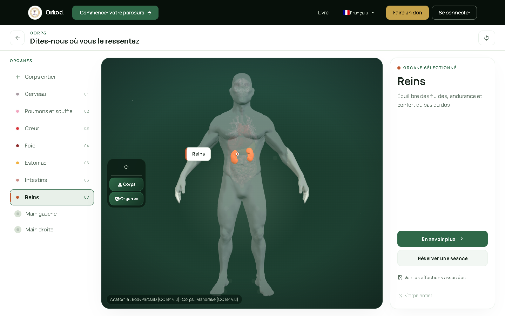
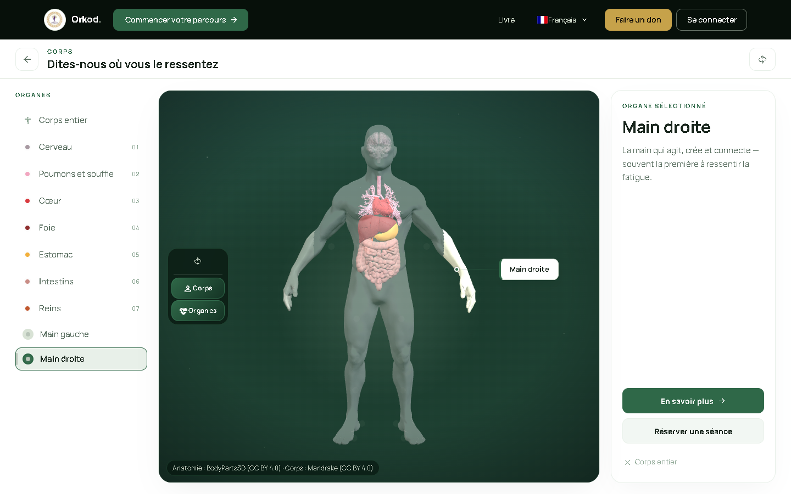

# Nature Green R16 Browser Audit (2026-11-06)

**Target:** https://localhost (Caddy -> Vite dev, self-signed)  
**Viewport:** 1440x900 unless noted  
**Browser:** Playwright + Edge headless (GPU swiftshader)  
**Application branch/commit audited:** `nature-green-final` @ `39016a7` (R16 audit target state included `bad4041` redirect fix; tooling/docs cleanup committed at 39016a7, no app behavior changes)  
**Review branch:** `visual-review/nature-green-r16-2026-11-06` (orkod-review)  
**Review commit (this correction):** see git history on review branch (published HEAD after push).

## Correction (capture automation)
R16 `body-sel-*` and `body-canvas-*` screenshots were re-captured with corrected automation. For each organ/hand the script clicks the corresponding `.bx-selector-item`/`.bx-selector-item--hand` in DOM order (organs: Brain, Lungs & breath, Heart, Liver, Stomach, Intestines, Kidneys; hands: Left, Right), waits for `.bx-detail-title` and `.bx-callout-pill`, asserts the displayed region name matches the requested region, then captures. Page reset (`.bx-selector-all`) between selections. No application code changed.

| Target | Detail title (asserted) | Callout pill (asserted) | Selection file | Canvas file | Assert |
|---|---|---|---|---|---|
| brain | Cerveau | Cerveau | body-sel-Brain-1440.png | body-canvas-Brain.png | PASS |
| lungs | Poumons et souffle | Poumons et souffle | body-sel-Lungs___breath-1440.png | body-canvas-Lungs___breath.png | PASS |
| heart | Coeur | Coeur | body-sel-Heart-1440.png | body-canvas-Heart.png | PASS |
| liver | Foie | Foie | body-sel-Liver-1440.png | body-canvas-Liver.png | PASS |
| stomach | Estomac | Estomac | body-sel-Stomach-1440.png | body-canvas-Stomach.png | PASS |
| intestines | Intestins | Intestins | body-sel-Intestines-1440.png | body-canvas-Intestines.png | PASS |
| kidneys | Reins | Reins | body-sel-Kidneys-1440.png | body-canvas-Kidneys.png | PASS |
| leftHand | Main gauche | Main gauche | body-sel-Left_Hand-1440.png | body-canvas-Left_Hand.png | PASS |
| rightHand | Main droite | Main droite | body-sel-Right_Hand-1440.png | body-canvas-Right_Hand.png | PASS |

Assertion log: `body-capture-assertions.json` ([raw](https://raw.githubusercontent.com/rezoroyone-dev/orkod-review/visual-review/nature-green-r16-2026-11-06/r16-2026-11-06/body-capture-assertions.json))

## Scope
1. `/body` organ + hand color assignments vs spec (source-of-truth) and rendered captures for human review.
2. `/body` load/performance sanity (1440x900).
3. Nav/CTA audit across 19 public routes (active route, visible internal hrefs, `/donate` redirect).
4. No deploy. No image perception used for color judgment.

## 1) /body color assignments (source-of-truth verified)
`frontend/src/data/anatomy.ts` `REGION_COLORS` matches the requested spec and is applied in `frontend/src/components/body/HumanBody3D.vue` `organMaterial(region)` (MeshStandard `color`/`emissive` tinted from region color; hands share the hand palette):

| Region | Expected hex | Source |
|---|---:|---|
| Brain | `#a89aa2` | anatomy `REGION_COLORS.brain` / Vue `organMaterial` |
| Lungs & breath | `#f2a6c0` | anatomy `REGION_COLORS.lungs` / Vue `organMaterial` |
| Heart | `#d93a3f` | anatomy `REGION_COLORS.heart` / Vue `organMaterial` |
| Liver | `#8f2f2f` | anatomy `REGION_COLORS.liver` / Vue `organMaterial` |
| Stomach | `#f2b03c` | anatomy `REGION_COLORS.stomach` / Vue `organMaterial` |
| Intestines | `#c98d86` | anatomy `REGION_COLORS.intestines` / Vue `organMaterial` |
| Kidneys | `#c0572e` | anatomy `REGION_COLORS.kidneys` / Vue `organMaterial` |
| Left Hand | `#b8c4b8` | anatomy `REGION_COLORS.handLeft` / Vue `organMaterial` |
| Right Hand | `#b8c4b8` | anatomy `REGION_COLORS.handRight` / Vue `organMaterial` |

### Rendered evidence (human review required)
Headless swiftshader 2D snapshot pixel sampling returned black/empty dominant colors (canvas `getContext('2d')` snapshot over WebGL); heuristic/ROI sampling over saved PNGs was confounded by stage lighting, emissive material, and the translucent body shell (ROI top-by-saturation samples skew toward muted green shell tones; Brain ROI empty in that heuristic). **Per-organ on-screen hex cannot be concluded from automation here.** Source assignments are correct; use the per-organ captures below for human visual judgment.

Raw base: `https://raw.githubusercontent.com/rezoroyone-dev/orkod-review/visual-review/nature-green-r16-2026-11-06/r16-2026-11-06`

| Region | Expected | Selection (1440) | Canvas crop | ROI crop |
|---|---:|---|---|---|
| Brain | `#a89aa2` | [sel](body-sel-Brain-1440.png) - [raw](https://raw.githubusercontent.com/rezoroyone-dev/orkod-review/visual-review/nature-green-r16-2026-11-06/r16-2026-11-06/body-sel-Brain-1440.png) | [canvas](body-canvas-Brain.png) - [raw](https://raw.githubusercontent.com/rezoroyone-dev/orkod-review/visual-review/nature-green-r16-2026-11-06/r16-2026-11-06/body-canvas-Brain.png) | [roi](body-roi-Brain.png) - [raw](https://raw.githubusercontent.com/rezoroyone-dev/orkod-review/visual-review/nature-green-r16-2026-11-06/r16-2026-11-06/body-roi-Brain.png) |
| Lungs & breath | `#f2a6c0` | [sel](body-sel-Lungs___breath-1440.png) - [raw](https://raw.githubusercontent.com/rezoroyone-dev/orkod-review/visual-review/nature-green-r16-2026-11-06/r16-2026-11-06/body-sel-Lungs___breath-1440.png) | [canvas](body-canvas-Lungs___breath.png) - [raw](https://raw.githubusercontent.com/rezoroyone-dev/orkod-review/visual-review/nature-green-r16-2026-11-06/r16-2026-11-06/body-canvas-Lungs___breath.png) | [roi](body-roi-Lungs___breath.png) - [raw](https://raw.githubusercontent.com/rezoroyone-dev/orkod-review/visual-review/nature-green-r16-2026-11-06/r16-2026-11-06/body-roi-Lungs___breath.png) |
| Heart | `#d93a3f` | [sel](body-sel-Heart-1440.png) - [raw](https://raw.githubusercontent.com/rezoroyone-dev/orkod-review/visual-review/nature-green-r16-2026-11-06/r16-2026-11-06/body-sel-Heart-1440.png) | [canvas](body-canvas-Heart.png) - [raw](https://raw.githubusercontent.com/rezoroyone-dev/orkod-review/visual-review/nature-green-r16-2026-11-06/r16-2026-11-06/body-canvas-Heart.png) | [roi](body-roi-Heart.png) - [raw](https://raw.githubusercontent.com/rezoroyone-dev/orkod-review/visual-review/nature-green-r16-2026-11-06/r16-2026-11-06/body-roi-Heart.png) |
| Liver | `#8f2f2f` | [sel](body-sel-Liver-1440.png) - [raw](https://raw.githubusercontent.com/rezoroyone-dev/orkod-review/visual-review/nature-green-r16-2026-11-06/r16-2026-11-06/body-sel-Liver-1440.png) | [canvas](body-canvas-Liver.png) - [raw](https://raw.githubusercontent.com/rezoroyone-dev/orkod-review/visual-review/nature-green-r16-2026-11-06/r16-2026-11-06/body-canvas-Liver.png) | [roi](body-roi-Liver.png) - [raw](https://raw.githubusercontent.com/rezoroyone-dev/orkod-review/visual-review/nature-green-r16-2026-11-06/r16-2026-11-06/body-roi-Liver.png) |
| Stomach | `#f2b03c` | [sel](body-sel-Stomach-1440.png) - [raw](https://raw.githubusercontent.com/rezoroyone-dev/orkod-review/visual-review/nature-green-r16-2026-11-06/r16-2026-11-06/body-sel-Stomach-1440.png) | [canvas](body-canvas-Stomach.png) - [raw](https://raw.githubusercontent.com/rezoroyone-dev/orkod-review/visual-review/nature-green-r16-2026-11-06/r16-2026-11-06/body-canvas-Stomach.png) | [roi](body-roi-Stomach.png) - [raw](https://raw.githubusercontent.com/rezoroyone-dev/orkod-review/visual-review/nature-green-r16-2026-11-06/r16-2026-11-06/body-roi-Stomach.png) |
| Intestines | `#c98d86` | [sel](body-sel-Intestines-1440.png) - [raw](https://raw.githubusercontent.com/rezoroyone-dev/orkod-review/visual-review/nature-green-r16-2026-11-06/r16-2026-11-06/body-sel-Intestines-1440.png) | [canvas](body-canvas-Intestines.png) - [raw](https://raw.githubusercontent.com/rezoroyone-dev/orkod-review/visual-review/nature-green-r16-2026-11-06/r16-2026-11-06/body-canvas-Intestines.png) | [roi](body-roi-Intestines.png) - [raw](https://raw.githubusercontent.com/rezoroyone-dev/orkod-review/visual-review/nature-green-r16-2026-11-06/r16-2026-11-06/body-roi-Intestines.png) |
| Kidneys | `#c0572e` | [sel](body-sel-Kidneys-1440.png) - [raw](https://raw.githubusercontent.com/rezoroyone-dev/orkod-review/visual-review/nature-green-r16-2026-11-06/r16-2026-11-06/body-sel-Kidneys-1440.png) | [canvas](body-canvas-Kidneys.png) - [raw](https://raw.githubusercontent.com/rezoroyone-dev/orkod-review/visual-review/nature-green-r16-2026-11-06/r16-2026-11-06/body-canvas-Kidneys.png) | [roi](body-roi-Kidneys.png) - [raw](https://raw.githubusercontent.com/rezoroyone-dev/orkod-review/visual-review/nature-green-r16-2026-11-06/r16-2026-11-06/body-roi-Kidneys.png) |
| Left Hand | `#b8c4b8` | [sel](body-sel-Left_Hand-1440.png) - [raw](https://raw.githubusercontent.com/rezoroyone-dev/orkod-review/visual-review/nature-green-r16-2026-11-06/r16-2026-11-06/body-sel-Left_Hand-1440.png) | [canvas](body-canvas-Left_Hand.png) - [raw](https://raw.githubusercontent.com/rezoroyone-dev/orkod-review/visual-review/nature-green-r16-2026-11-06/r16-2026-11-06/body-canvas-Left_Hand.png) | [roi](body-roi-Left_Hand.png) - [raw](https://raw.githubusercontent.com/rezoroyone-dev/orkod-review/visual-review/nature-green-r16-2026-11-06/r16-2026-11-06/body-roi-Left_Hand.png) |
| Right Hand | `#b8c4b8` | [sel](body-sel-Right_Hand-1440.png) - [raw](https://raw.githubusercontent.com/rezoroyone-dev/orkod-review/visual-review/nature-green-r16-2026-11-06/r16-2026-11-06/body-sel-Right_Hand-1440.png) | [canvas](body-canvas-Right_Hand.png) - [raw](https://raw.githubusercontent.com/rezoroyone-dev/orkod-review/visual-review/nature-green-r16-2026-11-06/r16-2026-11-06/body-canvas-Right_Hand.png) | [roi](body-roi-Right_Hand.png) - [raw](https://raw.githubusercontent.com/rezoroyone-dev/orkod-review/visual-review/nature-green-r16-2026-11-06/r16-2026-11-06/body-roi-Right_Hand.png) |

Machine reports (not definitive for lit color): `body-color-report.json` ([raw](https://raw.githubusercontent.com/rezoroyone-dev/orkod-review/visual-review/nature-green-r16-2026-11-06/r16-2026-11-06/body-color-report.json)), `body-color-report-v2.json` ([raw](https://raw.githubusercontent.com/rezoroyone-dev/orkod-review/visual-review/nature-green-r16-2026-11-06/r16-2026-11-06/body-color-report-v2.json)), `body-color-report-v3.json` ([raw](https://raw.githubusercontent.com/rezoroyone-dev/orkod-review/visual-review/nature-green-r16-2026-11-06/r16-2026-11-06/body-color-report-v3.json)), `body-roi-report.json` ([raw](https://raw.githubusercontent.com/rezoroyone-dev/orkod-review/visual-review/nature-green-r16-2026-11-06/r16-2026-11-06/body-roi-report.json)).

## Contact sheet (human visual review)
| Region | Selection preview | Raw |
|---|---|---|
| Brain |  | [raw](https://raw.githubusercontent.com/rezoroyone-dev/orkod-review/visual-review/nature-green-r16-2026-11-06/r16-2026-11-06/body-sel-Brain-1440.png) |
| Lungs & breath |  | [raw](https://raw.githubusercontent.com/rezoroyone-dev/orkod-review/visual-review/nature-green-r16-2026-11-06/r16-2026-11-06/body-sel-Lungs___breath-1440.png) |
| Heart |  | [raw](https://raw.githubusercontent.com/rezoroyone-dev/orkod-review/visual-review/nature-green-r16-2026-11-06/r16-2026-11-06/body-sel-Heart-1440.png) |
| Liver |  | [raw](https://raw.githubusercontent.com/rezoroyone-dev/orkod-review/visual-review/nature-green-r16-2026-11-06/r16-2026-11-06/body-sel-Liver-1440.png) |
| Stomach |  | [raw](https://raw.githubusercontent.com/rezoroyone-dev/orkod-review/visual-review/nature-green-r16-2026-11-06/r16-2026-11-06/body-sel-Stomach-1440.png) |
| Intestines |  | [raw](https://raw.githubusercontent.com/rezoroyone-dev/orkod-review/visual-review/nature-green-r16-2026-11-06/r16-2026-11-06/body-sel-Intestines-1440.png) |
| Kidneys |  | [raw](https://raw.githubusercontent.com/rezoroyone-dev/orkod-review/visual-review/nature-green-r16-2026-11-06/r16-2026-11-06/body-sel-Kidneys-1440.png) |
| Left Hand |  | [raw](https://raw.githubusercontent.com/rezoroyone-dev/orkod-review/visual-review/nature-green-r16-2026-11-06/r16-2026-11-06/body-sel-Left_Hand-1440.png) |
| Right Hand |  | [raw](https://raw.githubusercontent.com/rezoroyone-dev/orkod-review/visual-review/nature-green-r16-2026-11-06/r16-2026-11-06/body-sel-Right_Hand-1440.png) |

## 2) /body performance sanity (1440x900)
Measured via `page.evaluate` timestamps + performance resource/memory (Chromium): canvas present ~2.7s, settled ~5.7s from nav start; 9 selection cycles (Brain, Lungs & breath, Heart, Liver, Stomach, Intestines, Kidneys, Left Hand, Right Hand) completed with detail shown; per-select waits/cycle ~1.57-2.91s including UI settle/reset waits (not pure render). JS heap ~80 MB used / ~105 MB total (where available). No crash, no obvious freeze, no demonstrated regression; not a lab GPU benchmark. Licensed 3D model not replaced.

## 3) Nav/CTA audit (19 routes)
Checked routes: `/`, `/start`, `/home`, `/body`, `/symptoms`, `/practitioners`, `/doctors`, `/academy`, `/community`, `/consultations`, `/assistant`, `/donations`, `/family`, `/book`, `/contact`, `/login`, `/quiz`, `/booking`, `/donate` (public crawl; auth-guarded routes observed). **1 flag** (static asset, not a broken internal route):
- `/body` -> `unknown-route-target` href `/models/anatomy/ATTRIBUTION.md` (text `Anatomy: BodyParts3D (CC BY 4.0) - Body: Mandrake (CC BY 4.0)`) - HTTP 200 static file served by Vite; not an SPA navigation target.

`/donate` final URL: `https://localhost/donations` (redirect intact). No broken internal CTAs/routes, no incorrect redirects, and no unintended auth gates found in this crawl. Detail: `nav-audit.json` ([raw](https://raw.githubusercontent.com/rezoroyone-dev/orkod-review/visual-review/nature-green-r16-2026-11-06/r16-2026-11-06/nav-audit.json)).

## Residual risk
- Exact rendered on-screen organ/hand hex under current lighting/shell requires **human visual confirmation** (captures provided). Source colors are correct.
- `/models/anatomy/ATTRIBUTION.md` is a valid asset link but surfaced as an unknown SPA route target by the crawler heuristic.
