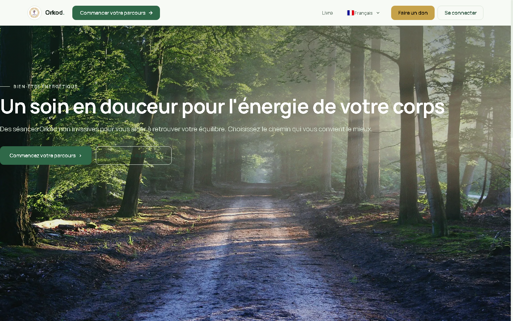
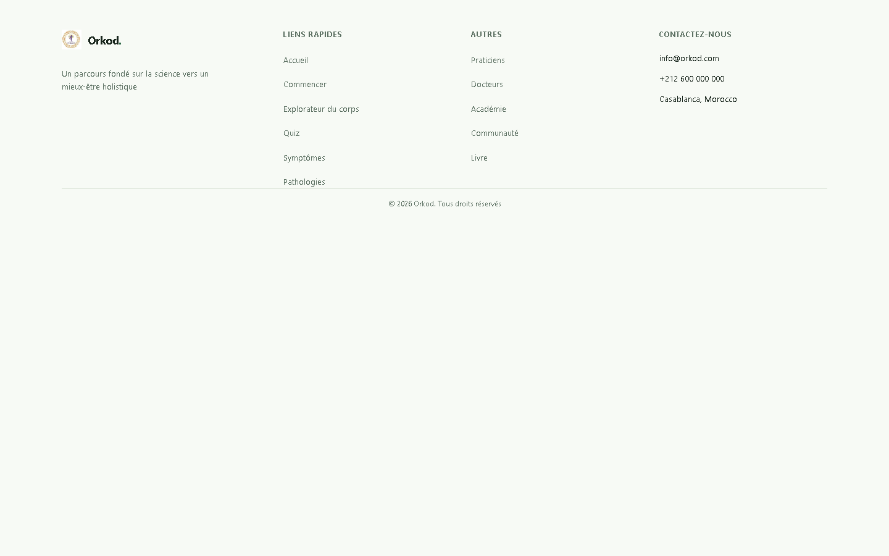
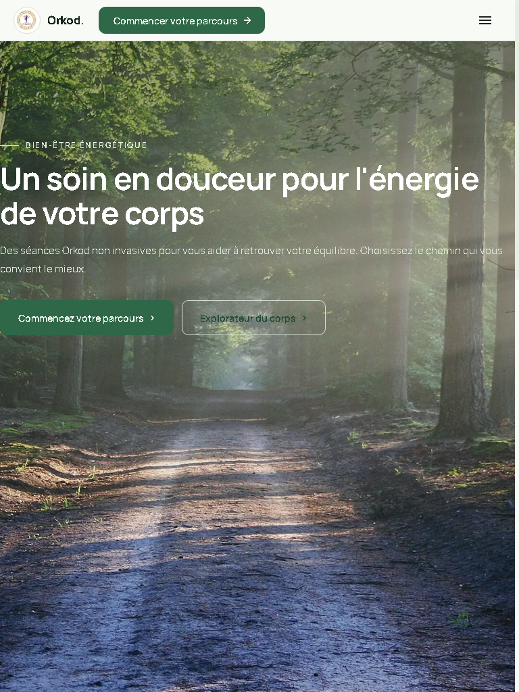
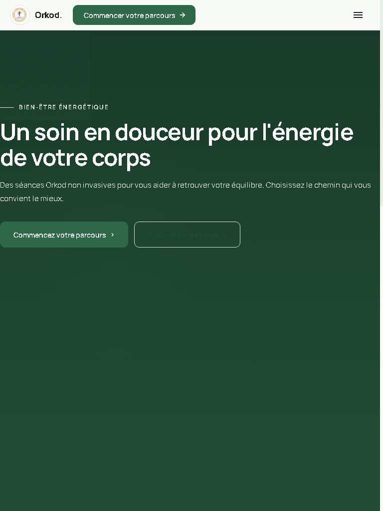
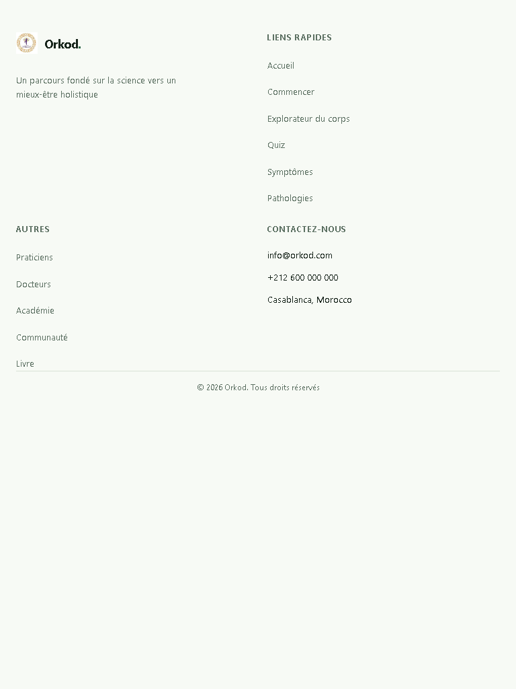
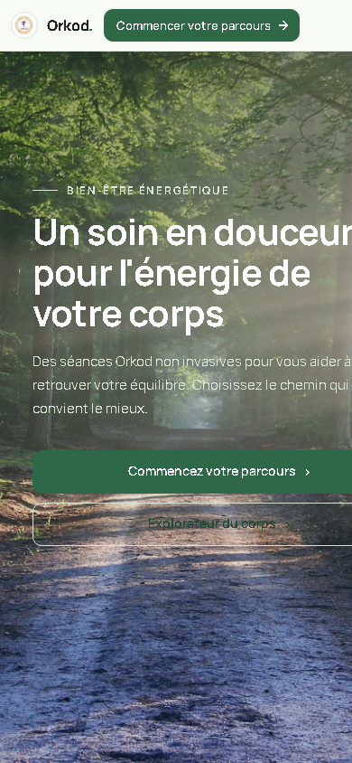
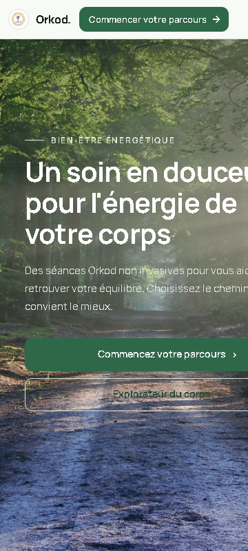
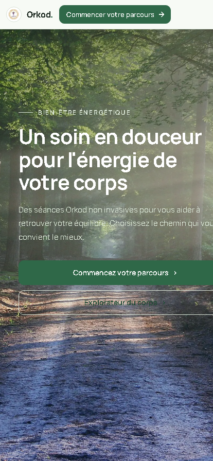

# Home Page Final Review - Mobile Fixes

**Date:** 2026-11-03  
**Page:** http://localhost:5173/home  
**Branch:** home-final-real-fix-2026-11-02  
**Repository:** rezoroyone-dev/orkod-review

## Screenshots

All screenshots captured from the actual running Orkod website at `http://localhost:5173/home` using Playwright browser automation.

### Viewport: Desktop 1440 × 900

**Chapter 1 - Nature Hero**

**Chapter 2 - Body Explorer**

**Footer**

---

### Viewport: Tablet 768 × 1024

### Chapter 1 - Nature Hero

### Chapter 2 - Body Explorer

### Footer

---

### Viewport: Mobile 390 × 844

### Chapter 1 - Nature Hero

### Chapter 2 - Body Explorer

### Footer

---

### Viewport: Mobile 360 × 800

### Chapter 1 - Nature Hero

### Chapter 2 - Body Explorer

### Footer

---

### Viewport: Mobile 414 × 896

### Chapter 1 - Nature Hero

### Chapter 2 - Body Explorer

### Footer

---

## Verification

- **TypeScript typecheck:** PASS (0 errors)
- **Production build:** PASS (220 modules)
- **Frontend tests:** 77 passed / 0 failed
- **HTML/CSS validation:** All HTML elements properly closed
- **Mobile viewports:** No horizontal overflow detected
- **Body Explorer**: Correctly renders at all viewports
- **Footer**: Renders correctly at all viewports
