# Orkod — Nature Green · Round 17 Visual Review

Current visual state of the public Orkod site, captured on **2026-10-21** by
`frontend/scripts/verify-round17.mjs` against the running site at `https://localhost`.
This branch contains **screenshots and this index only** — no application source
was modified or published for this round.

- **21 PNG screenshots** (desktop 1440×900 and mobile 390×844), captured after the
  Round 16 `/start` and homepage book-section corrections and after the Round 17
  fix that stops the fixed section rail from covering the chapter-02 copy.
- **1 contact sheet** (`contact-sheet.png`) for a quick overall look.
- **1 verification report** (`verification-report.txt`) — the raw log of the 12
  automated groups that produced these captures (12 passed / 0 failed).

**Scope note.** The automated harness proves DOM geometry, computed styles,
overflow, locale switching, colour scans and console errors. It does **not**
judge visual quality. These images exist so the visual result can be inspected
directly before any further design work is proposed.

---

## Priority review order

The sequence a reviewer should look at first, in this order:

1. [Language gate](#1-language-gate) — `r17-01-language-gate.png`
2. [/start — neutral state](#2-start--journey-entry) — `r17-02-start-neutral.png`
3. [/start — "I know why I'm sick" preview](#2-start--journey-entry) — `r17-03-start-left-preview.png`
4. [/start — "I don't know why I'm sick" preview](#2-start--journey-entry) — `r17-04-start-right-preview.png`
5. [Homepage chapter 01](#3-homepage) — `r17-05-home-chapter-1.png`
6. [Homepage chapter 02 — book section](#3-homepage) — `r17-06-home-chapter-2.png`
7. [Book page](#4-book-page) — `r17-08-book.png`
8. [Login / authentication gate](#5-authentication-gate) — `r17-09-login-gate.png`
9. [Body explorer — default](#6-body-explorer) — `r17-10-body-default.png`
10. [Body explorer — brain selected](#6-body-explorer) — `r17-11-body-brain.png`
11. [Donations](#7-donations) — `r17-12-donations.png`

Mobile equivalents are in [Mobile (390×844)](#9-mobile-390844) and the Arabic
capture is in [Arabic / RTL](#8-arabic--rtl).

---

## Quick contact sheet

<a href="contact-sheet.png">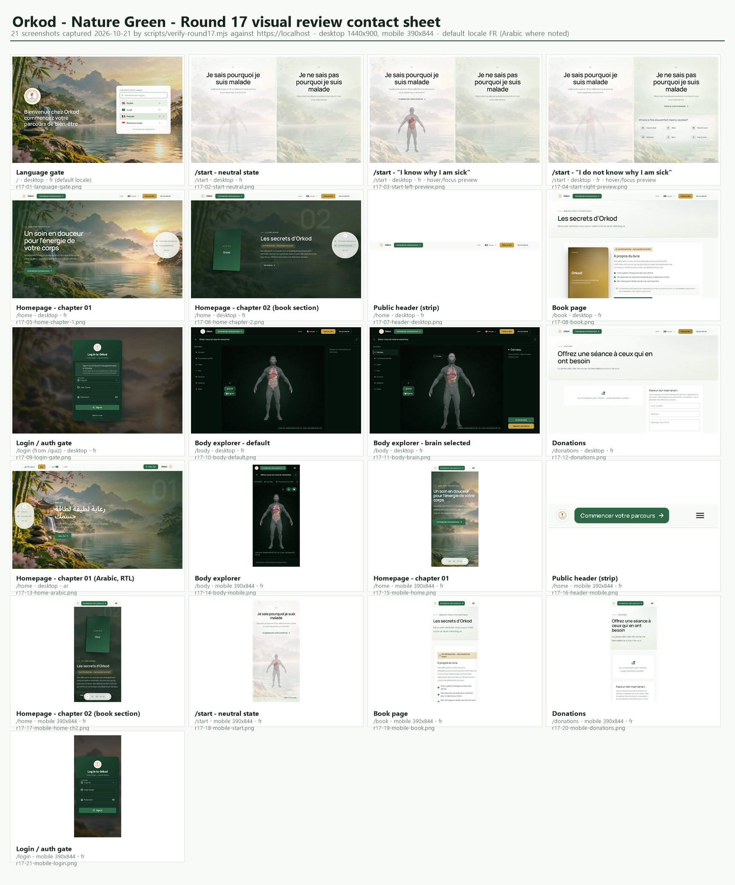</a>

---

## 1. Language gate

| Preview | File | Route | Viewport | Locale | What it shows |
| --- | --- | --- | --- | --- | --- |
| <a href="r17-01-language-gate.png"></a> | `r17-01-language-gate.png` | `/` (language gate) | 1440×900 desktop | fr (default) | First-paint language picker over the nature wash — four locale rows, search field, Orkod mark. |

## 2. /start — journey entry

| Preview | File | Route | Viewport | Locale | What it shows |
| --- | --- | --- | --- | --- | --- |
| <a href="r17-02-start-neutral.png">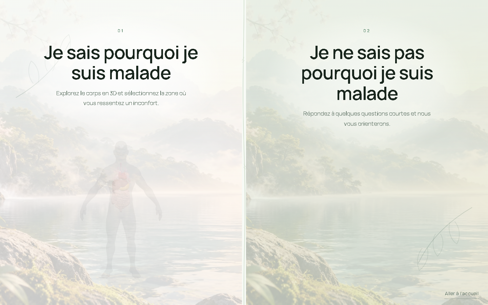</a> | `r17-02-start-neutral.png` | `/start` | 1440×900 desktop | fr | Resting state: two entry panels, both body previews nearly hidden (0.16 opacity) over the nature wash, skip link present. |
| <a href="r17-03-start-left-preview.png">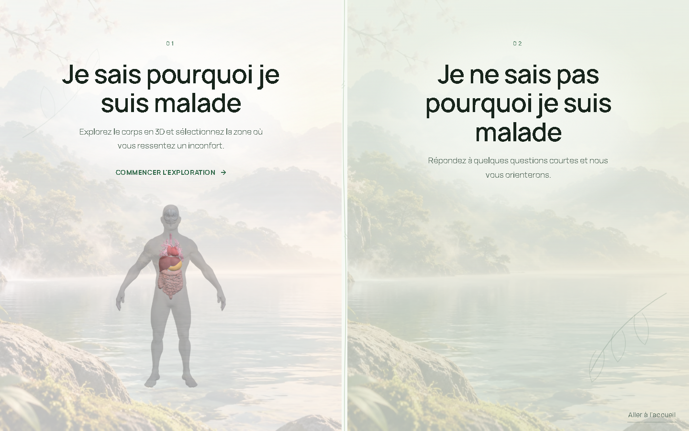</a> | `r17-03-start-left-preview.png` | `/start` | 1440×900 desktop | fr | Left panel focused — "I know why I'm sick": full-bleed body preview revealed above the copy (opacity 0.90, feathered edges). Clicking it continues to `/body`. |
| <a href="r17-04-start-right-preview.png">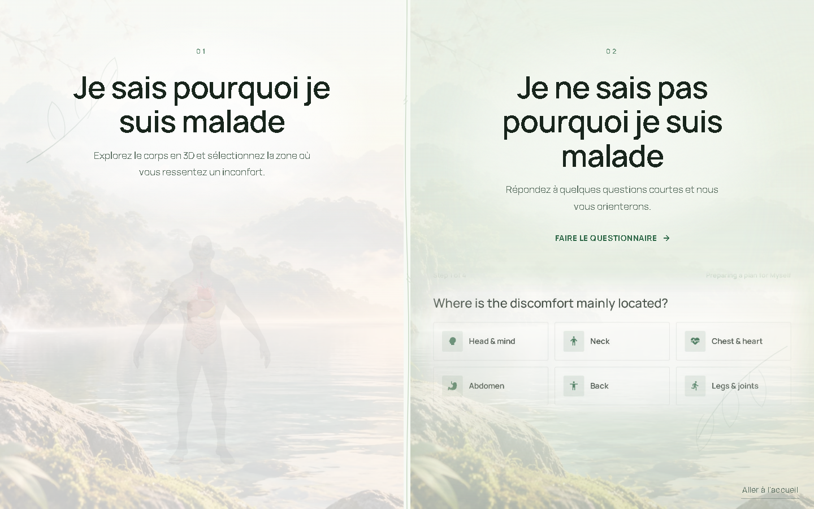</a> | `r17-04-start-right-preview.png` | `/start` | 1440×900 desktop | fr | Right panel focused — "I don't know why I'm sick": quiz preview revealed (opacity 0.78). Clicking it continues to `/quiz` (auth-gated). |

## 3. Homepage

| Preview | File | Route | Viewport | Locale | What it shows |
| --- | --- | --- | --- | --- | --- |
| <a href="r17-05-home-chapter-1.png">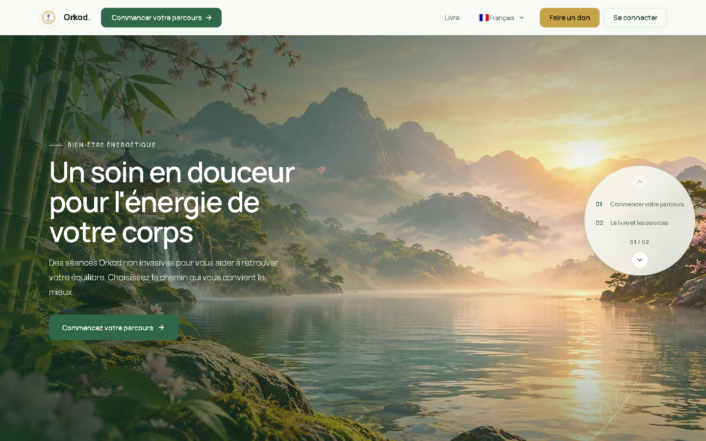</a> | `r17-05-home-chapter-1.png` | `/home` (chapter 01) | 1440×900 desktop | fr | Immersive nature hero — full-bleed forest photo, readable veil on the copy side, "Commencer votre parcours" CTA, chapter indicator 01 / 02. |
| <a href="r17-06-home-chapter-2.png">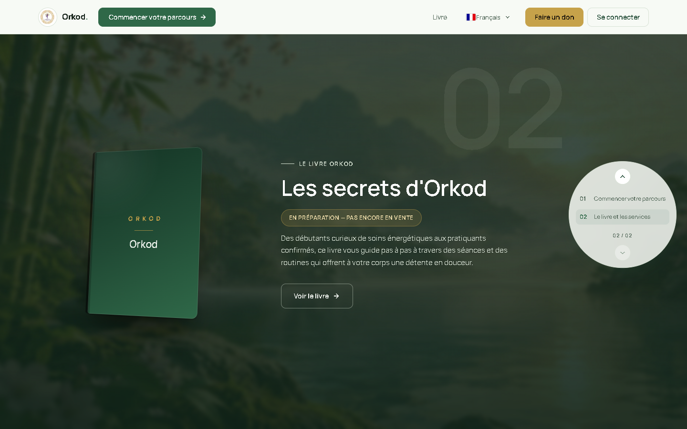</a> | `r17-06-home-chapter-2.png` | `/home` (chapter 02) | 1440×900 desktop | fr | Book section — 3D book stage over the softened book backdrop, book status line "En préparation — pas encore en vente", copy column and the fixed section rail with clear separation. |
| <a href="r17-07-header-desktop.png">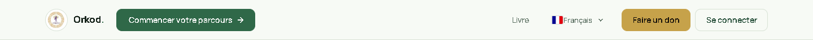</a> | `r17-07-header-desktop.png` | `/home` (header crop) | 1440×72 desktop | fr | Guest public header only — Orkod mark, nav entries, "Commencer votre parcours", "Faire un don", "Se connecter". |

## 4. Book page

| Preview | File | Route | Viewport | Locale | What it shows |
| --- | --- | --- | --- | --- | --- |
| <a href="r17-08-book.png">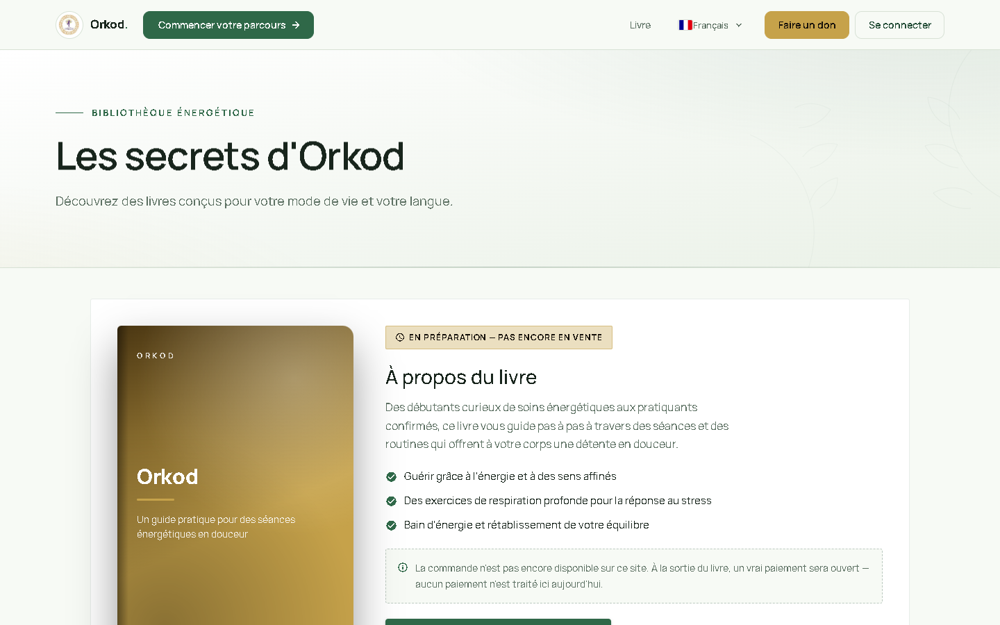</a> | `r17-08-book.png` | `/book` | 1440×900 desktop | fr | Public book page — hero, "En préparation — pas encore en vente" badge, honest availability note (no payment is processed yet), highlights list, booking CTA. |

## 5. Authentication gate

| Preview | File | Route | Viewport | Locale | What it shows |
| --- | --- | --- | --- | --- | --- |
| <a href="r17-09-login-gate.png">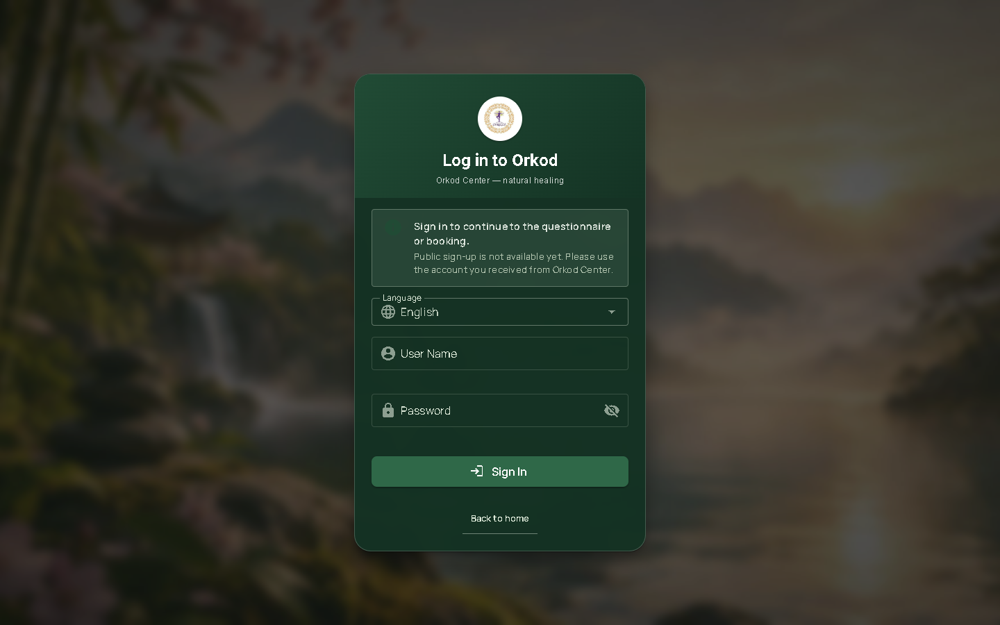</a> | `r17-09-login-gate.png` | `/login?redirect=/quiz` | 1440×900 desktop | fr | Gate reached from `/quiz` — Orkod-branded login card, explanation that the destination is kept, back link to `/home`, no autoplaying audio. |

## 6. Body explorer

| Preview | File | Route | Viewport | Locale | What it shows |
| --- | --- | --- | --- | --- | --- |
| <a href="r17-10-body-default.png">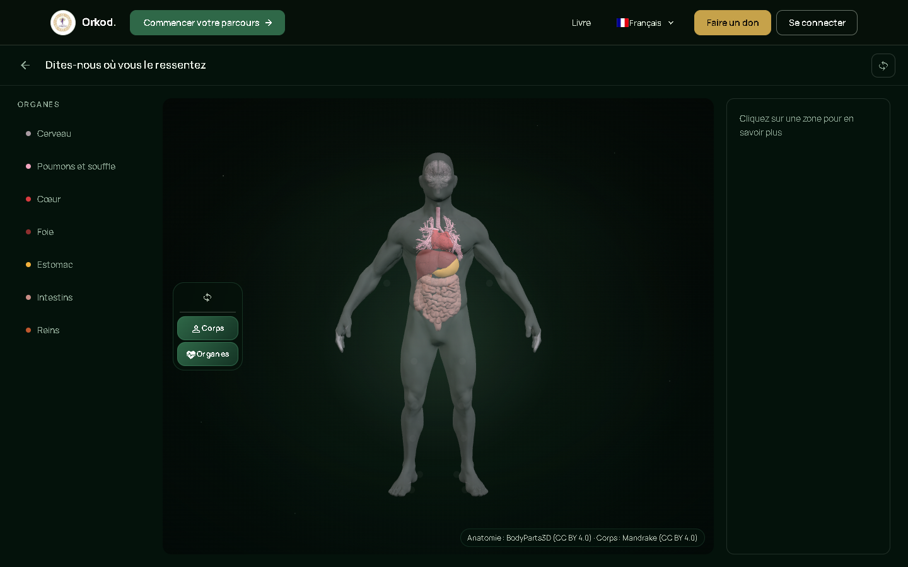</a> | `r17-10-body-default.png` | `/body` | 1440×900 desktop | fr | Default state — 3D body stage with the seven-organ selector rail, empty detail panel with its neutral hint, no callout. |
| <a href="r17-11-body-brain.png">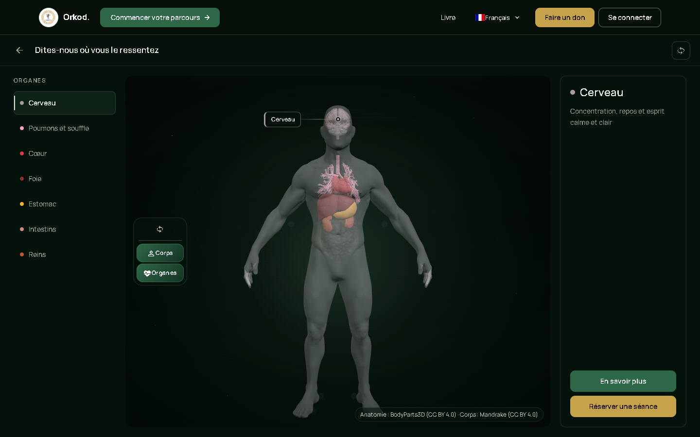</a> | `r17-11-body-brain.png` | `/body` | 1440×900 desktop | fr | "Cerveau" (brain) selected — camera focus on the head, one active selector row, marker dot inside the canvas, detail panel populated. |

## 7. Donations

| Preview | File | Route | Viewport | Locale | What it shows |
| --- | --- | --- | --- | --- | --- |
| <a href="r17-12-donations.png">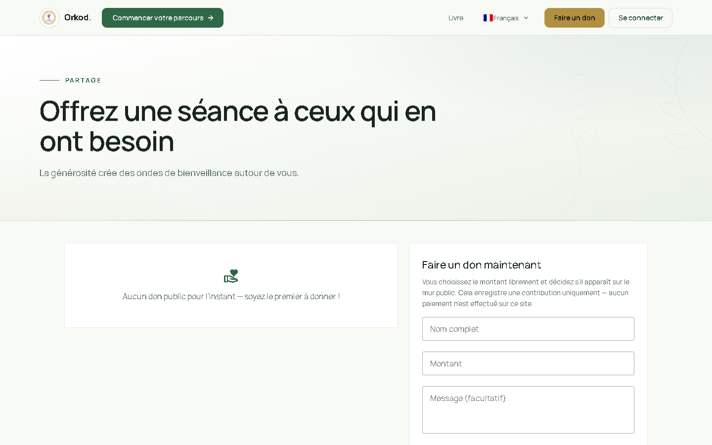</a> | `r17-12-donations.png` | `/donations` | 1440×900 desktop | fr | Donations page — heading and content, no legacy gold treatment left. |

## 8. Arabic / RTL

| Preview | File | Route | Viewport | Locale | What it shows |
| --- | --- | --- | --- | --- | --- |
| <a href="r17-13-home-arabic.png"></a> | `r17-13-home-arabic.png` | `/home` (chapter 01) | 1440×900 desktop | ar (`dir=rtl`) | Homepage in Arabic — RTL mirroring, Arabic display font, translated hero copy. |

## 9. Mobile (390×844)

| Preview | File | Route | Viewport | Locale | What it shows |
| --- | --- | --- | --- | --- | --- |
| <a href="r17-18-mobile-start.png">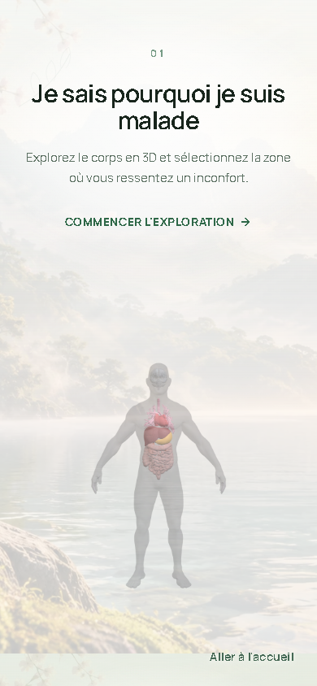</a> | `r17-18-mobile-start.png` | `/start` | 390×844 mobile | fr | Stacked entry panels, both previews visible (0.72 / 0.78 opacity), no horizontal overflow, no site header. |
| <a href="r17-15-mobile-home.png">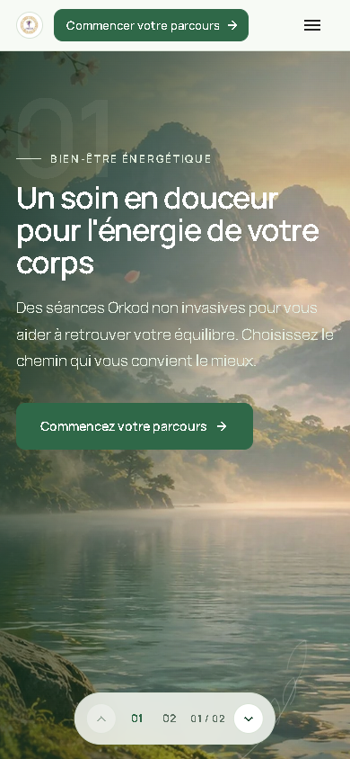</a> | `r17-15-mobile-home.png` | `/home` (chapter 01) | 390×844 mobile | fr | Mobile hero chapter — nature photo, copy block, bottom chapter navigator. |
| <a href="r17-17-mobile-home-ch2.png">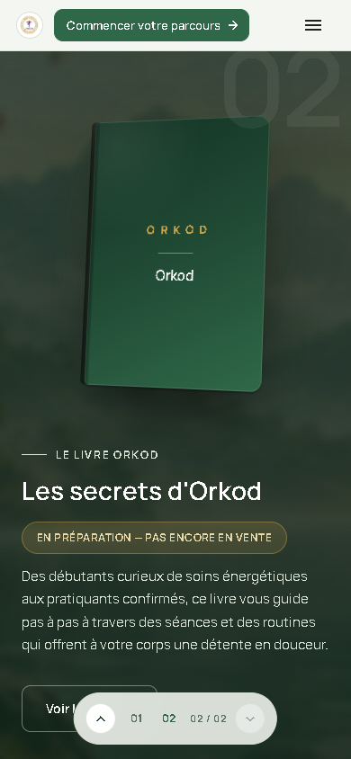</a> | `r17-17-mobile-home-ch2.png` | `/home` (chapter 02) | 390×844 mobile | fr | Mobile book chapter — book stage above the copy, book status line, indicator 02 / 02 kept on one line. |
| <a href="r17-14-body-mobile.png">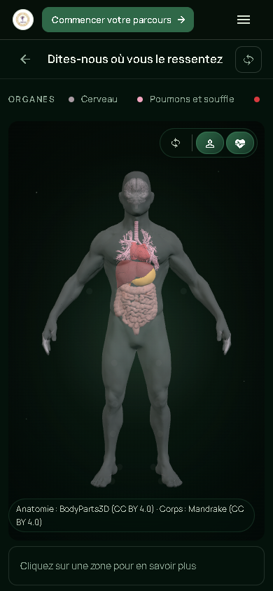</a> | `r17-14-body-mobile.png` | `/body` | 390×844 mobile | fr | Mobile body explorer — stacked organ selectors, no horizontal overflow. |
| <a href="r17-19-mobile-book.png">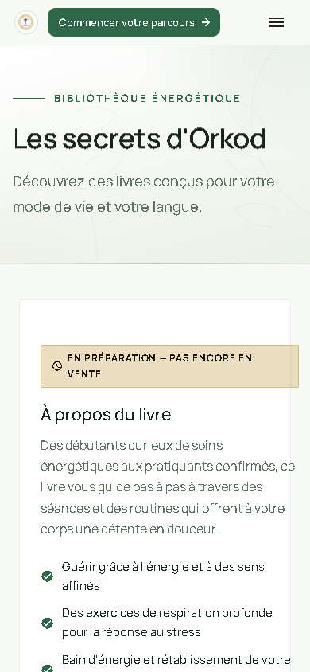</a> | `r17-19-mobile-book.png` | `/book` | 390×844 mobile | fr | Mobile book page. |
| <a href="r17-20-mobile-donations.png"></a> | `r17-20-mobile-donations.png` | `/donations` | 390×844 mobile | fr | Mobile donations page. |
| <a href="r17-21-mobile-login.png">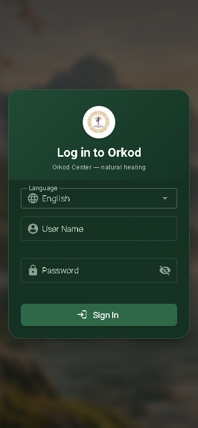</a> | `r17-21-mobile-login.png` | `/login` | 390×844 mobile | fr | Mobile login / authentication gate. |
| <a href="r17-16-header-mobile.png"></a> | `r17-16-header-mobile.png` | `/home` (header crop) | 390×57 mobile | fr | Mobile public header only — mark, menu, "Se connecter". |

## 10. Supporting files

| File | What it is |
| --- | --- |
| [`contact-sheet.png`](contact-sheet.png) | 1728×2080 contact sheet of all 21 screenshots, captioned. |
| [`verification-report.txt`](verification-report.txt) | Raw log of the Round 17 harness run: 12 groups, 12 passed / 0 failed, with the measured values. |

---

## Full-resolution raw URLs

Every file is also reachable directly (useful for image-capable tooling):

```
https://raw.githubusercontent.com/rezoroyone-dev/orkod-review/visual-review/nature-green-round-17/screenshots/nature-green-round-17/<file>
```

| File | Raw URL |
| --- | --- |
| `r17-01-language-gate.png` | https://raw.githubusercontent.com/rezoroyone-dev/orkod-review/visual-review/nature-green-round-17/screenshots/nature-green-round-17/r17-01-language-gate.png |
| `r17-02-start-neutral.png` | https://raw.githubusercontent.com/rezoroyone-dev/orkod-review/visual-review/nature-green-round-17/screenshots/nature-green-round-17/r17-02-start-neutral.png |
| `r17-03-start-left-preview.png` | https://raw.githubusercontent.com/rezoroyone-dev/orkod-review/visual-review/nature-green-round-17/screenshots/nature-green-round-17/r17-03-start-left-preview.png |
| `r17-04-start-right-preview.png` | https://raw.githubusercontent.com/rezoroyone-dev/orkod-review/visual-review/nature-green-round-17/screenshots/nature-green-round-17/r17-04-start-right-preview.png |
| `r17-05-home-chapter-1.png` | https://raw.githubusercontent.com/rezoroyone-dev/orkod-review/visual-review/nature-green-round-17/screenshots/nature-green-round-17/r17-05-home-chapter-1.png |
| `r17-06-home-chapter-2.png` | https://raw.githubusercontent.com/rezoroyone-dev/orkod-review/visual-review/nature-green-round-17/screenshots/nature-green-round-17/r17-06-home-chapter-2.png |
| `r17-07-header-desktop.png` | https://raw.githubusercontent.com/rezoroyone-dev/orkod-review/visual-review/nature-green-round-17/screenshots/nature-green-round-17/r17-07-header-desktop.png |
| `r17-08-book.png` | https://raw.githubusercontent.com/rezoroyone-dev/orkod-review/visual-review/nature-green-round-17/screenshots/nature-green-round-17/r17-08-book.png |
| `r17-09-login-gate.png` | https://raw.githubusercontent.com/rezoroyone-dev/orkod-review/visual-review/nature-green-round-17/screenshots/nature-green-round-17/r17-09-login-gate.png |
| `r17-10-body-default.png` | https://raw.githubusercontent.com/rezoroyone-dev/orkod-review/visual-review/nature-green-round-17/screenshots/nature-green-round-17/r17-10-body-default.png |
| `r17-11-body-brain.png` | https://raw.githubusercontent.com/rezoroyone-dev/orkod-review/visual-review/nature-green-round-17/screenshots/nature-green-round-17/r17-11-body-brain.png |
| `r17-12-donations.png` | https://raw.githubusercontent.com/rezoroyone-dev/orkod-review/visual-review/nature-green-round-17/screenshots/nature-green-round-17/r17-12-donations.png |
| `r17-13-home-arabic.png` | https://raw.githubusercontent.com/rezoroyone-dev/orkod-review/visual-review/nature-green-round-17/screenshots/nature-green-round-17/r17-13-home-arabic.png |
| `r17-14-body-mobile.png` | https://raw.githubusercontent.com/rezoroyone-dev/orkod-review/visual-review/nature-green-round-17/screenshots/nature-green-round-17/r17-14-body-mobile.png |
| `r17-15-mobile-home.png` | https://raw.githubusercontent.com/rezoroyone-dev/orkod-review/visual-review/nature-green-round-17/screenshots/nature-green-round-17/r17-15-mobile-home.png |
| `r17-16-header-mobile.png` | https://raw.githubusercontent.com/rezoroyone-dev/orkod-review/visual-review/nature-green-round-17/screenshots/nature-green-round-17/r17-16-header-mobile.png |
| `r17-17-mobile-home-ch2.png` | https://raw.githubusercontent.com/rezoroyone-dev/orkod-review/visual-review/nature-green-round-17/screenshots/nature-green-round-17/r17-17-mobile-home-ch2.png |
| `r17-18-mobile-start.png` | https://raw.githubusercontent.com/rezoroyone-dev/orkod-review/visual-review/nature-green-round-17/screenshots/nature-green-round-17/r17-18-mobile-start.png |
| `r17-19-mobile-book.png` | https://raw.githubusercontent.com/rezoroyone-dev/orkod-review/visual-review/nature-green-round-17/screenshots/nature-green-round-17/r17-19-mobile-book.png |
| `r17-20-mobile-donations.png` | https://raw.githubusercontent.com/rezoroyone-dev/orkod-review/visual-review/nature-green-round-17/screenshots/nature-green-round-17/r17-20-mobile-donations.png |
| `r17-21-mobile-login.png` | https://raw.githubusercontent.com/rezoroyone-dev/orkod-review/visual-review/nature-green-round-17/screenshots/nature-green-round-17/r17-21-mobile-login.png |
| `contact-sheet.png` | https://raw.githubusercontent.com/rezoroyone-dev/orkod-review/visual-review/nature-green-round-17/screenshots/nature-green-round-17/contact-sheet.png |
| `verification-report.txt` | https://raw.githubusercontent.com/rezoroyone-dev/orkod-review/visual-review/nature-green-round-17/screenshots/nature-green-round-17/verification-report.txt |
