# Orkod — Nature Green · Round 19 Visual Review

Current visual state of the public Orkod site, captured on **2026-10-21** by
`frontend/scripts/verify-round19.mjs` and `frontend/scripts/capture-round19.mjs`
against the running site at `https://localhost`.
This branch contains **screenshots and this index only** — no application source
was modified or published for this round.

- **24 PNG screenshots** (desktop 1440×900, tablet 768×1024, laptop 1100×800,
  mobile 390×844 and 360×800) plus **1 contact sheet** (`contact-sheet.png`).
- **1 verification report** (`verification-report.txt`) — the raw log of the 12
  automated groups that produced these captures (12 passed / 0 failed).
- Every capture was pixel-checked (`frontend/scripts/pixel-check-round19.py`):
  no flat or blank renders.

**What Round 19 changed** (the reason the screenshots look different):

| Area | Round 19 fix |
| --- | --- |
| `/start` | The questionnaire panel renders the visitor's **own language** (the app's `Quiz_*` strings) instead of a baked capture of the English page; the anatomy preview rests at 0.46 instead of an invisible 0.16 and is `object-fit: contain`; the panels sit on a real CC0 forest plate with local gradients; on mobile the page scrolls naturally, shows "the other choice is below", and keeps a safe-area skip link. |
| Homepage 02 | The flat 0.62–0.74 wash is replaced by **local radial pools**; the photograph is graded instead of desaturated; the fixed chapter rail moved from a bottom pill (which covered the book CTA) to the **right edge** (left in RTL), with the content reserving that strip. |
| Book page | Rebuilt as a **concept spread**: a 3D book object with the real title, a "concept cover" label, a status ribbon that is the first thing on a phone, an honest availability note, and no price/purchase wording. The plural "des livres / كتبًا" copy now speaks of the single book. |
| Body explorer | The selection pulse scales each organ about **its own centre** instead of the world origin — the brain no longer grows out through the skull; the neutral panel now offers the seven organs as an understated selection affordance. |

**Scope note.** The automated harness proves DOM geometry, computed styles,
overflow, locale switching, colour scans, console errors and pixel content.
It does **not** judge visual taste. These images exist so the visual result can
be inspected directly.

---

## Priority review order

1. [Language gate](#1-language-gate) — `r19-01-language-gate.png`
2. [/start — neutral state](#2-start--journey-entry) — `r19-02-start-neutral.png`
3. [/start — anatomy choice revealed](#2-start--journey-entry) — `r19-03-start-body-hover.png`
4. [/start — localised questionnaire](#2-start--journey-entry) — `r19-04-start-quiz-hover.png`
5. [Homepage chapter 01](#3-homepage) — `r19-05-home-chapter-1.png`
6. [Homepage chapter 02 — book section](#3-homepage) — `r19-06-home-chapter-2.png`
7. [Homepage chapter 02 — mobile rail](#3-homepage) — `r19-08-mobile-home-390.png`
8. [Book page](#4-book-page) — `r19-09-book.png`
9. [Body explorer — brain selected](#6-body-explorer) — `r19-11-body-brain.png`
10. [Book page — Arabic](#7-arabic--rtl) — `r19-19-book-arabic.png`

---

## Quick contact sheet

<a href="contact-sheet.png">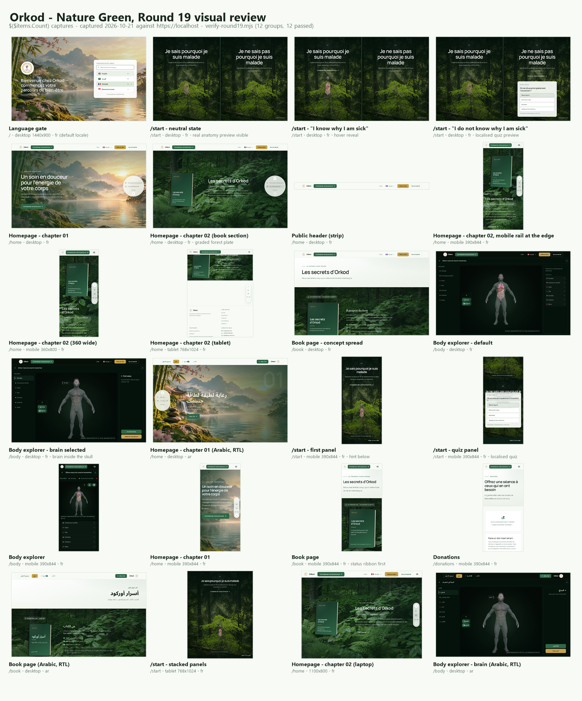</a>

---

## 1. Language gate

| Preview | File | Route | Viewport | Locale | What it shows |
| --- | --- | --- | --- | --- | --- |
| <a href="r19-01-language-gate.png"></a> | `r19-01-language-gate.png` | `/` (language gate) | 1440×900 desktop | fr (default) | First-paint language picker over the nature wash — four locale rows, search field, Orkod mark. Unchanged by Round 19. |

## 2. /start — journey entry

| Preview | File | Route | Viewport | Locale | What it shows |
| --- | --- | --- | --- | --- | --- |
| <a href="r19-02-start-neutral.png">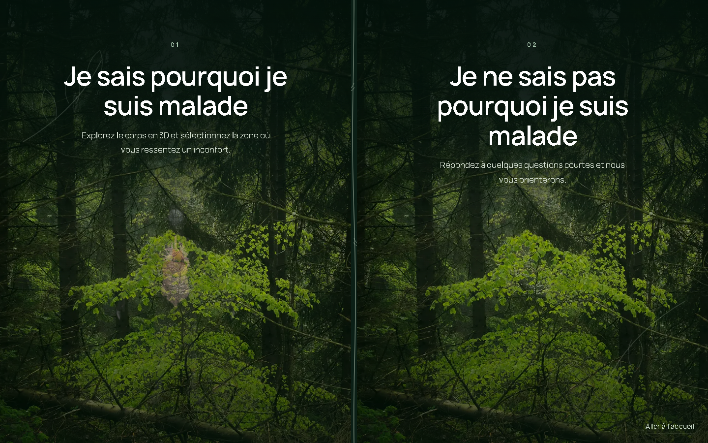</a> | `r19-02-start-neutral.png` | `/start` | 1440×900 desktop | fr | Resting state: two choice panels on a real forest plate, the anatomy figure readable (opacity 0.46, `contain`), the questionnaire hidden until hover, skip link to `/home`. |
| <a href="r19-03-start-body-hover.png">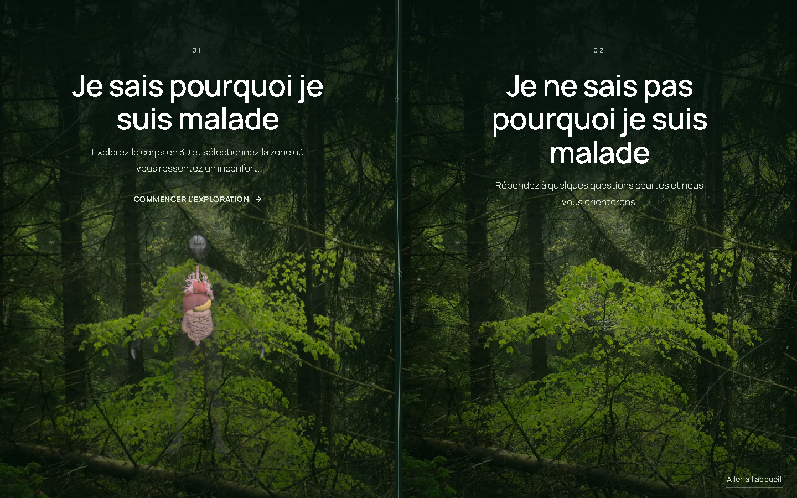</a> | `r19-03-start-body-hover.png` | `/start` | 1440×900 desktop | fr | "Je sais pourquoi je suis malade" — the anatomy figure gains presence (opacity 0.92) without leaving its panel. |
| <a href="r19-04-start-quiz-hover.png">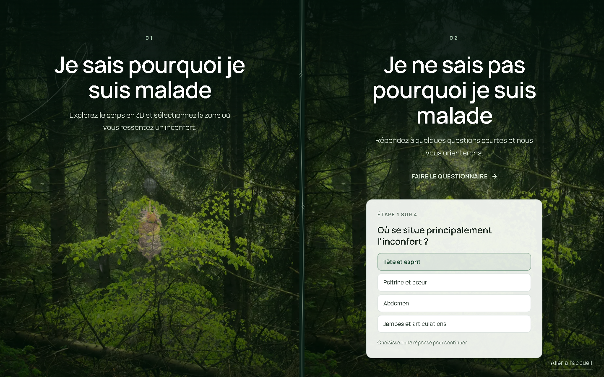</a> | `r19-04-start-quiz-hover.png` | `/start` | 1440×900 desktop | fr | "Je ne sais pourquoi je suis malade" — the questionnaire appears **in French**, rendered from the app's own strings, decorative (`aria-hidden`) so the panel stays a single button. |
| <a href="r19-20-start-tablet.png">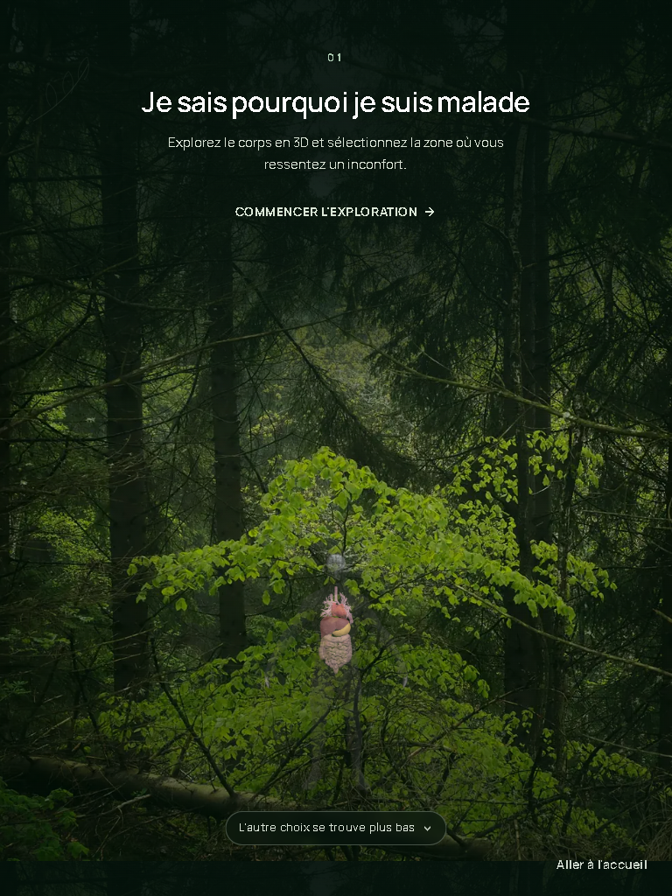</a> | `r19-20-start-tablet.png` | `/start` | 768×1024 tablet | fr | Stacked panels at tablet width — the framed preview window stays inside its own panel. |

## 3. Homepage

| Preview | File | Route | Viewport | Locale | What it shows |
| --- | --- | --- | --- | --- | --- |
| <a href="r19-05-home-chapter-1.png"></a> | `r19-05-home-chapter-1.png` | `/home` (chapter 01) | 1440×900 desktop | fr | Immersive nature hero, copy column, "Commencer votre parcours" CTA, chapter indicator 01 / 02. |
| <a href="r19-06-home-chapter-2.png">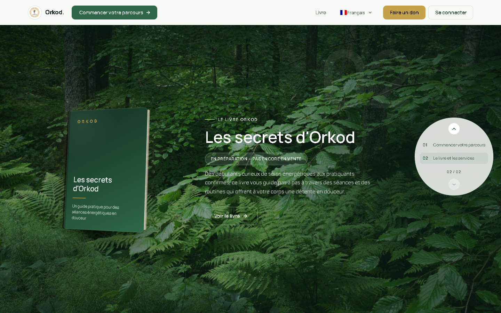</a> | `r19-06-home-chapter-2.png` | `/home` (chapter 02) | 1440×900 desktop | fr | Book section over the new graded forest plate — local gradient pools instead of a flat wash, the book object with the real title, the sage status ribbon "En préparation — pas encore en vente", and the edge rail clear of the copy. |
| <a href="r19-08-mobile-home-390.png">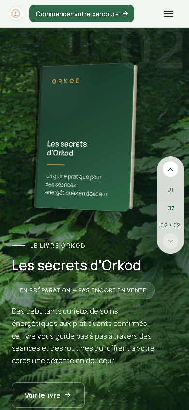</a> | `r19-08-mobile-home-390.png` | `/home` (chapter 02) | 390×844 mobile | fr | The chapter rail is a vertical edge rail (right in LTR); the book CTA and the copy are fully clear of it. |
| <a href="r19-08-mobile-home-360.png">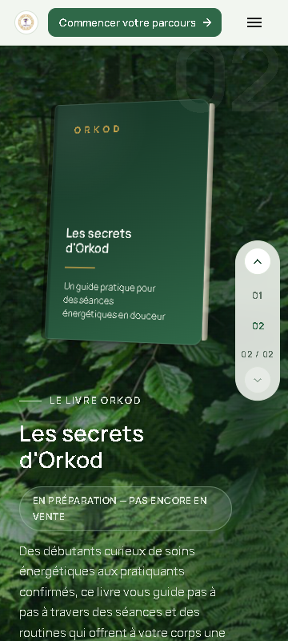</a> | `r19-08-mobile-home-360.png` | `/home` (chapter 02) | 360×800 mobile | fr | Same at the narrowest supported width — no collision, no horizontal overflow. |
| <a href="r19-08-mobile-home-768.png">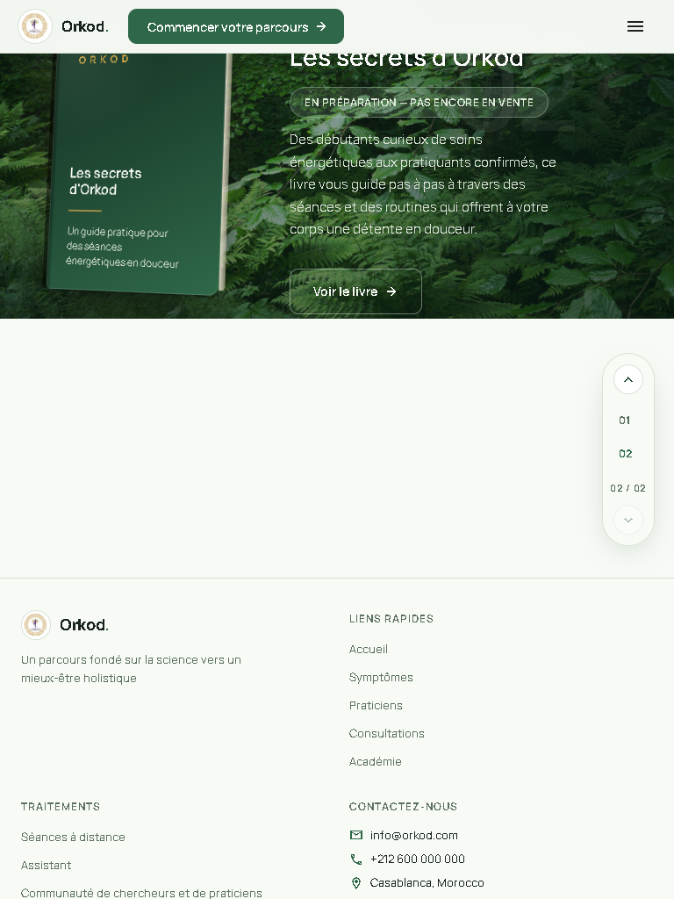</a> | `r19-08-mobile-home-768.png` | `/home` (chapter 02) | 768×1024 tablet | fr | Tablet width — the rail keeps its edge position, the CTA stays reachable. |
| <a href="r19-21-home-laptop-ch2.png">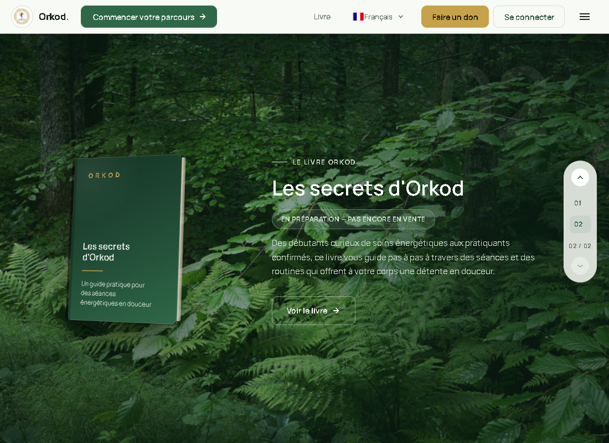</a> | `r19-21-home-laptop-ch2.png` | `/home` (chapter 02) | 1100×800 laptop | fr | Laptop width — the reserved rail strip keeps the book copy clear. |
| <a href="r19-07-header-desktop.png"></a> | `r19-07-header-desktop.png` | `/home` (header crop) | 1440×72 desktop | fr | Guest public header only — Orkod mark, nav entries, "Commencer votre parcours", "Faire un don", "Se connecter". |

## 4. Book page

| Preview | File | Route | Viewport | Locale | What it shows |
| --- | --- | --- | --- | --- | --- |
| <a href="r19-09-book.png">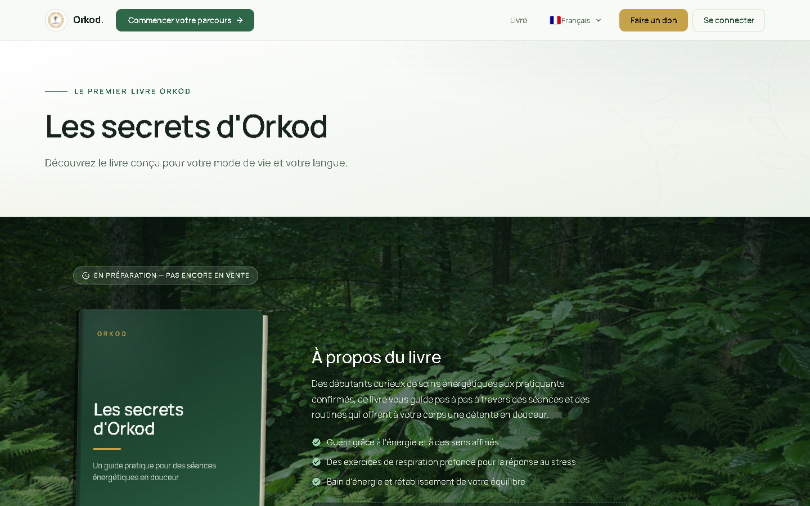</a> | `r19-09-book.png` | `/book` | 1440×900 desktop | fr | Concept spread — status ribbon first, 3D book object carrying the real title "Les secrets d'Orkod" with a "Couverture conceptuelle" label, honest availability note, highlights, booking CTA. No price, no purchase. |
| <a href="r19-17-mobile-book.png">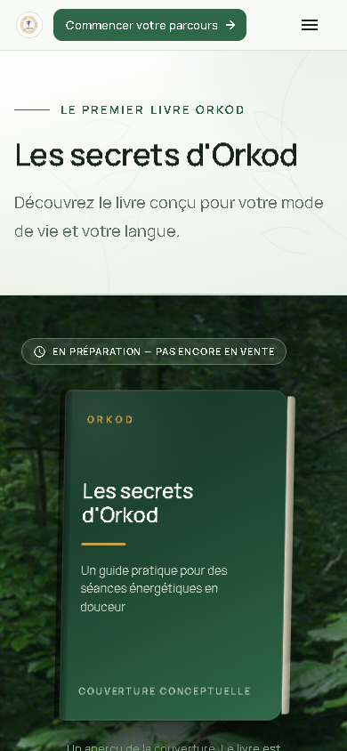</a> | `r19-17-mobile-book.png` | `/book` | 390×844 mobile | fr | Mobile order: status ribbon → cover → information. The honest state is read before the cover, and the cover never bleeds past the viewport. |

## 5. Body explorer

| Preview | File | Route | Viewport | Locale | What it shows |
| --- | --- | --- | --- | --- | --- |
| <a href="r19-10-body-default.png">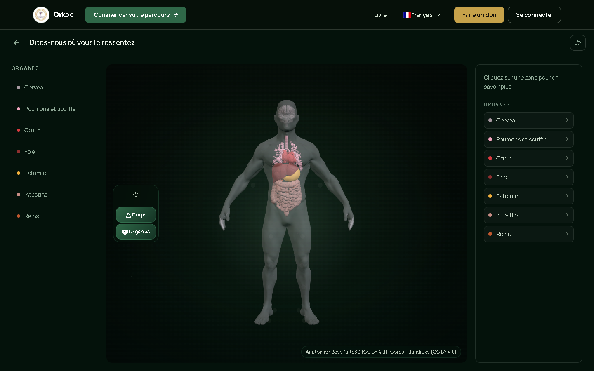</a> | `r19-10-body-default.png` | `/body` | 1440×900 desktop | fr | Default state — 3D body stage, seven-organ selector rail, and a neutral detail panel that now offers the seven organs as a selection affordance. |
| <a href="r19-11-body-brain.png">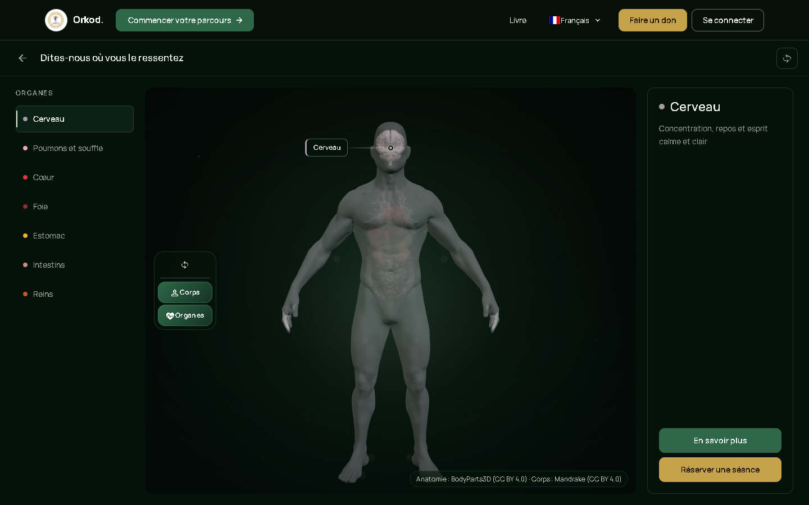</a> | `r19-11-body-brain.png` | `/body` | 1440×900 desktop | fr | "Cerveau" (brain) selected — camera focus on the head, marker dot inside the canvas, and the organ pulsing **about its own centre** so it stays inside the cranial cavity. |
| <a href="r19-15-body-mobile.png">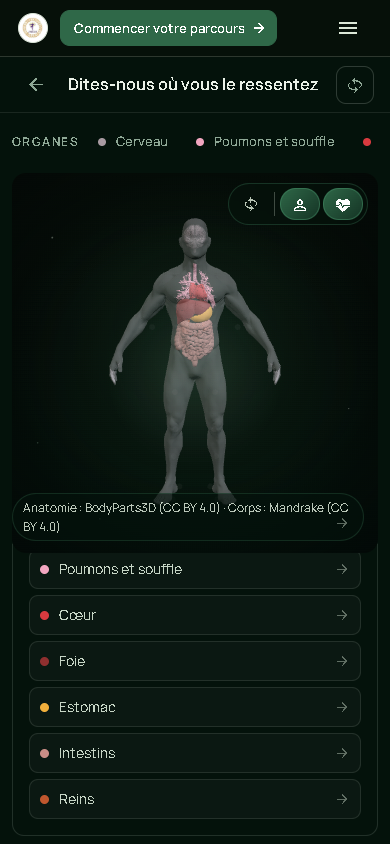</a> | `r19-15-body-mobile.png` | `/body` | 390×844 mobile | fr | Mobile body explorer — stacked organ selectors, no horizontal overflow. |

## 6. Donations

| Preview | File | Route | Viewport | Locale | What it shows |
| --- | --- | --- | --- | --- | --- |
| <a href="r19-18-mobile-donations.png">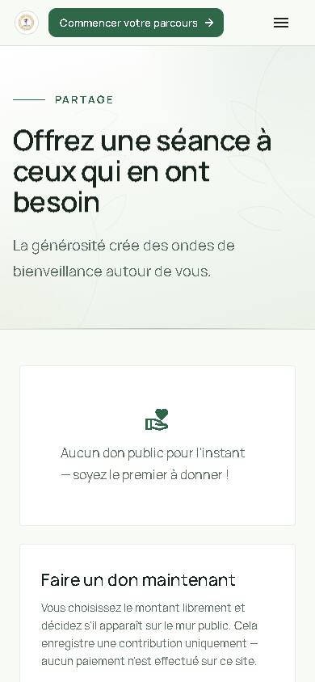</a> | `r19-18-mobile-donations.png` | `/donations` | 390×844 mobile | fr | Mobile donations page — unchanged by Round 19, kept as a regression reference. |

## 7. Arabic / RTL

| Preview | File | Route | Viewport | Locale | What it shows |
| --- | --- | --- | --- | --- | --- |
| <a href="r19-12-home-arabic.png">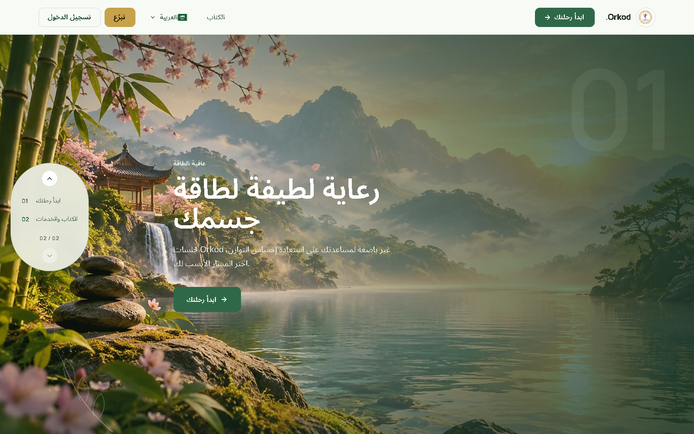</a> | `r19-12-home-arabic.png` | `/home` (chapter 01) | 1440×900 desktop | ar (`dir=rtl`) | Homepage in Arabic — RTL mirroring, Arabic display font, translated hero copy. |
| <a href="r19-19-book-arabic.png">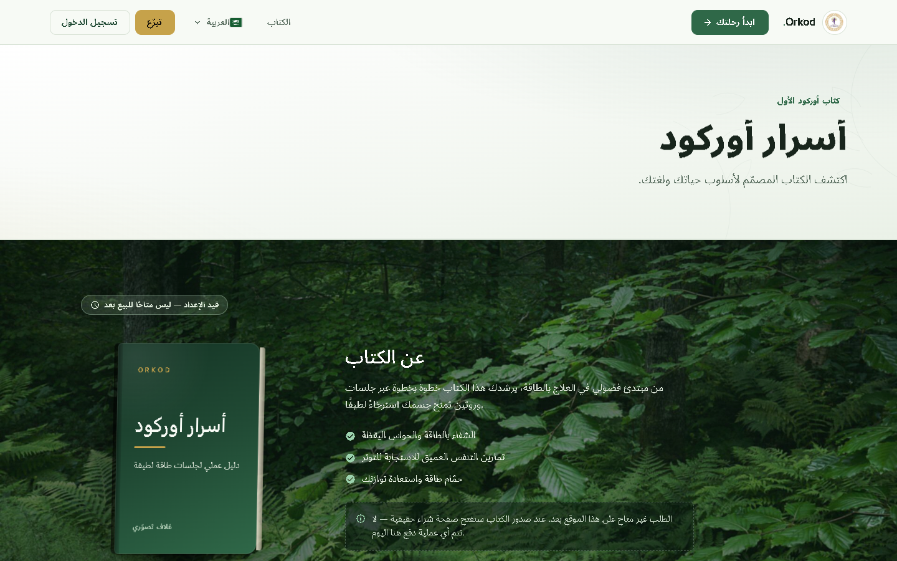</a> | `r19-19-book-arabic.png` | `/book` | 1440×900 desktop | ar (`dir=rtl`) | Book page in Arabic — the concept cover and the status ribbon mirror correctly. |
| <a href="r19-22-body-brain-arabic.png">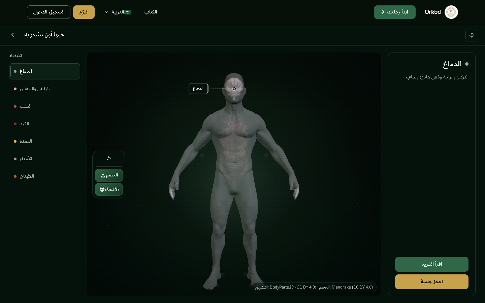</a> | `r19-22-body-brain-arabic.png` | `/body` | 1440×900 desktop | ar (`dir=rtl`) | Body explorer with the brain selected in Arabic — the 3D anatomy is **not** mirrored. |

## 8. Mobile (390×844)

| Preview | File | Route | Viewport | Locale | What it shows |
| --- | --- | --- | --- | --- | --- |
| <a href="r19-13-mobile-start.png">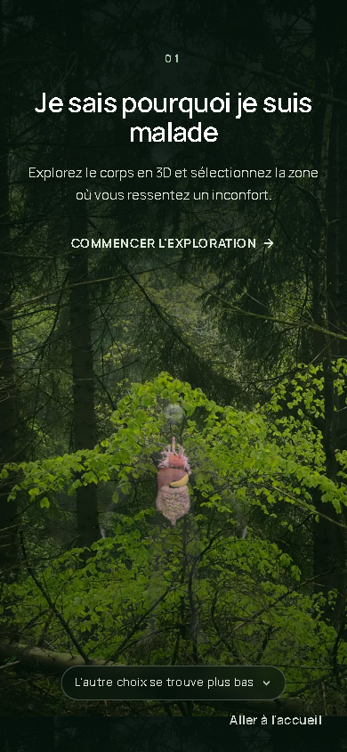</a> | `r19-13-mobile-start.png` | `/start` | 390×844 mobile | fr | First choice on a phone — copy on top, the framed anatomy window anchored at the foot of its own panel, and the quiet "L'autre choix se trouve plus bas" hint. Natural scrolling, no site header. |
| <a href="r19-14-mobile-start-bottom.png">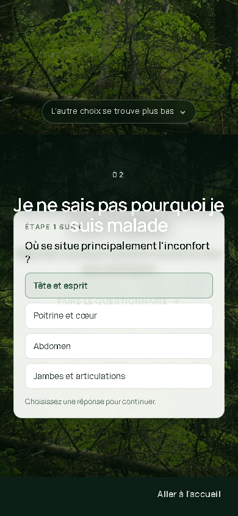</a> | `r19-14-mobile-start-bottom.png` | `/start` (scrolled) | 390×844 mobile | fr | The second choice — the questionnaire card in French, fully readable, with the skip link clear of the content. |

## 9. Supporting files

| File | What it is |
| --- | --- |
| [`contact-sheet.png`](contact-sheet.png) | 1728×2080 contact sheet of all 24 screenshots, captioned. |
| [`verification-report.txt`](verification-report.txt) | Raw log of the Round 19 harness run: 12 groups, 12 passed / 0 failed, with the measured values. |

---

## Full-resolution raw URLs

Every file is also reachable directly (useful for image-capable tooling):

```
https://raw.githubusercontent.com/rezoroyone-dev/orkod-review/visual-review/nature-green-round-19/screenshots/nature-green-round-19/<file>
```

| File | Raw URL |
| --- | --- |
| `r19-01-language-gate.png` | https://raw.githubusercontent.com/rezoroyone-dev/orkod-review/visual-review/nature-green-round-19/screenshots/nature-green-round-19/r19-01-language-gate.png |
| `r19-02-start-neutral.png` | https://raw.githubusercontent.com/rezoroyone-dev/orkod-review/visual-review/nature-green-round-19/screenshots/nature-green-round-19/r19-02-start-neutral.png |
| `r19-03-start-body-hover.png` | https://raw.githubusercontent.com/rezoroyone-dev/orkod-review/visual-review/nature-green-round-19/screenshots/nature-green-round-19/r19-03-start-body-hover.png |
| `r19-04-start-quiz-hover.png` | https://raw.githubusercontent.com/rezoroyone-dev/orkod-review/visual-review/nature-green-round-19/screenshots/nature-green-round-19/r19-04-start-quiz-hover.png |
| `r19-05-home-chapter-1.png` | https://raw.githubusercontent.com/rezoroyone-dev/orkod-review/visual-review/nature-green-round-19/screenshots/nature-green-round-19/r19-05-home-chapter-1.png |
| `r19-06-home-chapter-2.png` | https://raw.githubusercontent.com/rezoroyone-dev/orkod-review/visual-review/nature-green-round-19/screenshots/nature-green-round-19/r19-06-home-chapter-2.png |
| `r19-07-header-desktop.png` | https://raw.githubusercontent.com/rezoroyone-dev/orkod-review/visual-review/nature-green-round-19/screenshots/nature-green-round-19/r19-07-header-desktop.png |
| `r19-08-mobile-home-390.png` | https://raw.githubusercontent.com/rezoroyone-dev/orkod-review/visual-review/nature-green-round-19/screenshots/nature-green-round-19/r19-08-mobile-home-390.png |
| `r19-08-mobile-home-360.png` | https://raw.githubusercontent.com/rezoroyone-dev/orkod-review/visual-review/nature-green-round-19/screenshots/nature-green-round-19/r19-08-mobile-home-360.png |
| `r19-08-mobile-home-768.png` | https://raw.githubusercontent.com/rezoroyone-dev/orkod-review/visual-review/nature-green-round-19/screenshots/nature-green-round-19/r19-08-mobile-home-768.png |
| `r19-09-book.png` | https://raw.githubusercontent.com/rezoroyone-dev/orkod-review/visual-review/nature-green-round-19/screenshots/nature-green-round-19/r19-09-book.png |
| `r19-10-body-default.png` | https://raw.githubusercontent.com/rezoroyone-dev/orkod-review/visual-review/nature-green-round-19/screenshots/nature-green-round-19/r19-10-body-default.png |
| `r19-11-body-brain.png` | https://raw.githubusercontent.com/rezoroyone-dev/orkod-review/visual-review/nature-green-round-19/screenshots/nature-green-round-19/r19-11-body-brain.png |
| `r19-12-home-arabic.png` | https://raw.githubusercontent.com/rezoroyone-dev/orkod-review/visual-review/nature-green-round-19/screenshots/nature-green-round-19/r19-12-home-arabic.png |
| `r19-13-mobile-start.png` | https://raw.githubusercontent.com/rezoroyone-dev/orkod-review/visual-review/nature-green-round-19/screenshots/nature-green-round-19/r19-13-mobile-start.png |
| `r19-14-mobile-start-bottom.png` | https://raw.githubusercontent.com/rezoroyone-dev/orkod-review/visual-review/nature-green-round-19/screenshots/nature-green-round-19/r19-14-mobile-start-bottom.png |
| `r19-15-body-mobile.png` | https://raw.githubusercontent.com/rezoroyone-dev/orkod-review/visual-review/nature-green-round-19/screenshots/nature-green-round-19/r19-15-body-mobile.png |
| `r19-16-mobile-home.png` | https://raw.githubusercontent.com/rezoroyone-dev/orkod-review/visual-review/nature-green-round-19/screenshots/nature-green-round-19/r19-16-mobile-home.png |
| `r19-17-mobile-book.png` | https://raw.githubusercontent.com/rezoroyone-dev/orkod-review/visual-review/nature-green-round-19/screenshots/nature-green-round-19/r19-17-mobile-book.png |
| `r19-18-mobile-donations.png` | https://raw.githubusercontent.com/rezoroyone-dev/orkod-review/visual-review/nature-green-round-19/screenshots/nature-green-round-19/r19-18-mobile-donations.png |
| `r19-19-book-arabic.png` | https://raw.githubusercontent.com/rezoroyone-dev/orkod-review/visual-review/nature-green-round-19/screenshots/nature-green-round-19/r19-19-book-arabic.png |
| `r19-20-start-tablet.png` | https://raw.githubusercontent.com/rezoroyone-dev/orkod-review/visual-review/nature-green-round-19/screenshots/nature-green-round-19/r19-20-start-tablet.png |
| `r19-21-home-laptop-ch2.png` | https://raw.githubusercontent.com/rezoroyone-dev/orkod-review/visual-review/nature-green-round-19/screenshots/nature-green-round-19/r19-21-home-laptop-ch2.png |
| `r19-22-body-brain-arabic.png` | https://raw.githubusercontent.com/rezoroyone-dev/orkod-review/visual-review/nature-green-round-19/screenshots/nature-green-round-19/r19-22-body-brain-arabic.png |
| `contact-sheet.png` | https://raw.githubusercontent.com/rezoroyone-dev/orkod-review/visual-review/nature-green-round-19/screenshots/nature-green-round-19/contact-sheet.png |
| `verification-report.txt` | https://raw.githubusercontent.com/rezoroyone-dev/orkod-review/visual-review/nature-green-round-19/screenshots/nature-green-round-19/verification-report.txt |
