# Orkod — Nature Green · Round 20 Visual Review

Current visual state of the public Orkod site, captured on **2026-10-21** by
`frontend/scripts/verify-round20.mjs` and `frontend/scripts/capture-round20.mjs`
against the running site at `https://localhost`.
This branch contains **screenshots and this index only** — no application source
was modified or published for this round.

- **29 PNG screenshots** (desktop 1440×900, tablet 768×1024, laptop 1100×800,
  mobile 390×844 and 360×800) plus **1 contact sheet** (`contact-sheet.png`).
- **1 verification report** (`verification-report.txt`) — the raw log of the 17
  automated groups that produced these captures (17 passed / 0 failed).
- Every capture was pixel-checked (`frontend/scripts/pixel-check-round19.py`
  and `frontend/scripts/pixel-check-round20.py`): no flat or blank renders, and
  each Round 20 fix is measurably present in the pixels.

**What Round 20 changed** (the reason the screenshots look different):

| Area | Round 20 fix |
| --- | --- |
| `/start` (phone) | The questionnaire card is **in the flow** instead of an overlay: it no longer covers the heading, the copy or the call to action (was 55,014 px² over the content, 13,840 px² over the heading, 4,444 px² over the CTA — now **0 / 0 / 0**). |
| `/start` (figure) | The anatomy preview is a **whole human body** — head to toes — re-rendered with a four-point light rig, a fresnel rim and a calm neutral shell (`start-preview-body.png` 900×1413, `start-preview-body-mobile.png` 560×872). The alpha silhouette fills 90.9 % of the frame at a 0.601 aspect. |
| Body explorer — brain | The brain is **in the skull and visible**. Its anchor moved from the mesh bounding-box centre (eye level, 6.7 cm behind the face) to the upper-mass core, projected at **49.8 % / 37.5 %** of the stage against an independent three.js projection of **50.0 % / 37.5 %**. The head band is no longer a flat haze: standard deviation 56.3 against 27.6 for the Round 19 capture, with 10,481 lit pixels in the brain region. |
| Body explorer (phone) | The model credit became a **caption strip under the figure** instead of a corner pill over it (it covered 16,896 px² of the anatomy), and the detail panel no longer paints over the stage. Stage / detail / credit overlap: **0 px²** at 360, 390 and 768 px wide. |
| Book page | The concept cover was rebuilt as a **premium physical object**: a forest board with a woven cloth texture (measured micro-contrast 6.38 against 0.19 for the smooth Round 19 board), a bevel, a gold-foil title (2,171 gold pixels), an embossed leaf emblem and a botanical sprig. The pale page now meets the forest through an **arc and a mist** instead of a hard horizontal cut. The honesty wording is unchanged: "En préparation — pas encore en vente", a concept-cover label, no price, no purchase path. |

**Scope note.** The automated harness proves DOM geometry, computed styles,
overflow, locale switching, colour scans, console errors and pixel content.
It does **not** judge visual taste. These images exist so the visual result can
be inspected directly.

---

## Priority review order

1. [/start — neutral state](#2-start--journey-entry) — `r20-02-start-neutral.png`
2. [/start — whole-body preview](#2-start--journey-entry) — `r20-20-start-body-preview.png`
3. [/start — mobile questionnaire in flow](#8-mobile-390844) — `r20-29-mobile-start-quiz.png`
4. [Body explorer — brain selected](#5-body-explorer) — `r20-11-body-brain.png`
5. [Body explorer — brain (proof shot)](#5-body-explorer) — `r20-21-body-brain.png`
6. [Body explorer — mobile](#5-body-explorer) — `r20-22-mobile-body.png`
7. [Book page](#4-book-page) — `r20-09-book.png`
8. [Book page — cover](#4-book-page) — `r20-23-book-cover.png`
9. [Homepage chapter 02](#3-homepage) — `r20-06-home-chapter-2.png`
10. [Book page — Arabic](#7-arabic--rtl) — `r20-24-book-arabic.png`

---

## Quick contact sheet

<a href="contact-sheet.png">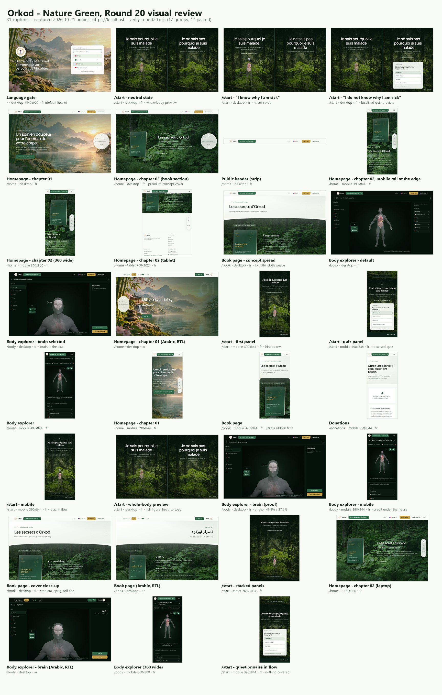</a>

---

## 1. Language gate

| Preview | File | Route | Viewport | Locale | What it shows |
| --- | --- | --- | --- | --- | --- |
| <a href="r20-01-language-gate.png">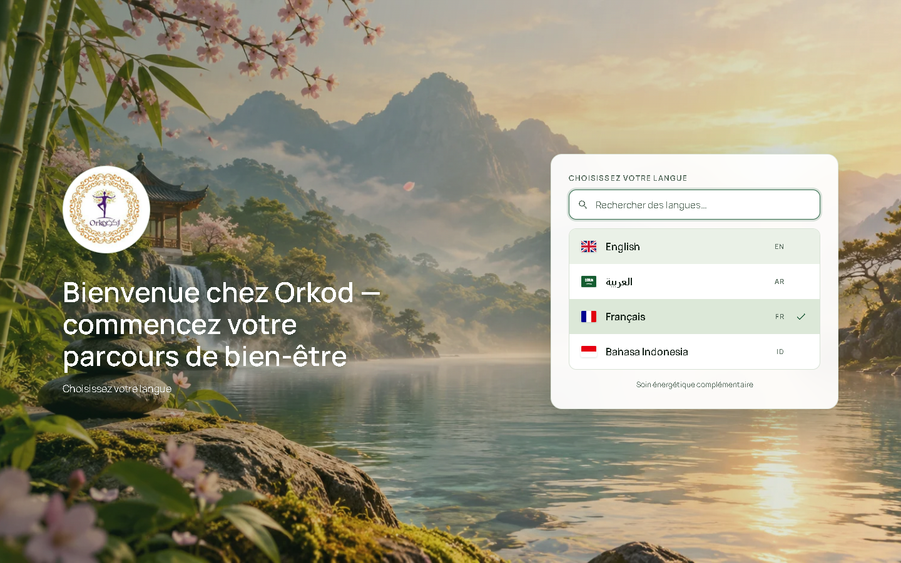</a> | `r20-01-language-gate.png` | `/` (language gate) | 1440×900 desktop | fr (default) | First-paint language picker over the nature wash — four locale rows, search field, Orkod mark. Unchanged by Round 20. |

## 2. /start — journey entry

| Preview | File | Route | Viewport | Locale | What it shows |
| --- | --- | --- | --- | --- | --- |
| <a href="r20-02-start-neutral.png">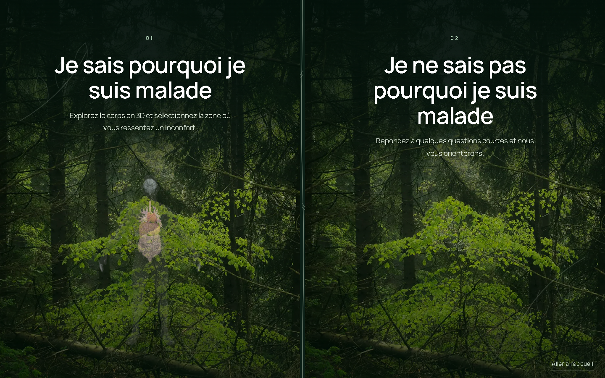</a> | `r20-02-start-neutral.png` | `/start` | 1440×900 desktop | fr | Resting state: two choice panels on a real forest plate, the **whole-body** anatomy figure readable (`object-fit: contain`), the questionnaire hidden until hover, skip link to `/home`. |
| <a href="r20-20-start-body-preview.png"></a> | `r20-20-start-body-preview.png` | `/start` | 1440×900 desktop | fr | The same view captured for the review — the figure is a complete human body, head to toes, not a crop of a torso. |
| <a href="r20-03-start-body-hover.png">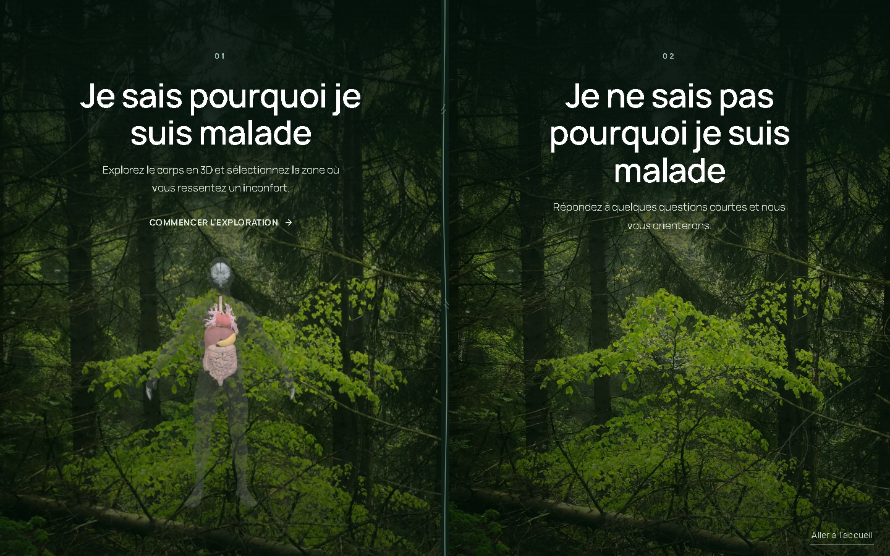</a> | `r20-03-start-body-hover.png` | `/start` | 1440×900 desktop | fr | "Je sais pourquoi je suis malade" — the anatomy figure gains presence (opacity 0.95) without leaving its panel. |
| <a href="r20-04-start-quiz-hover.png">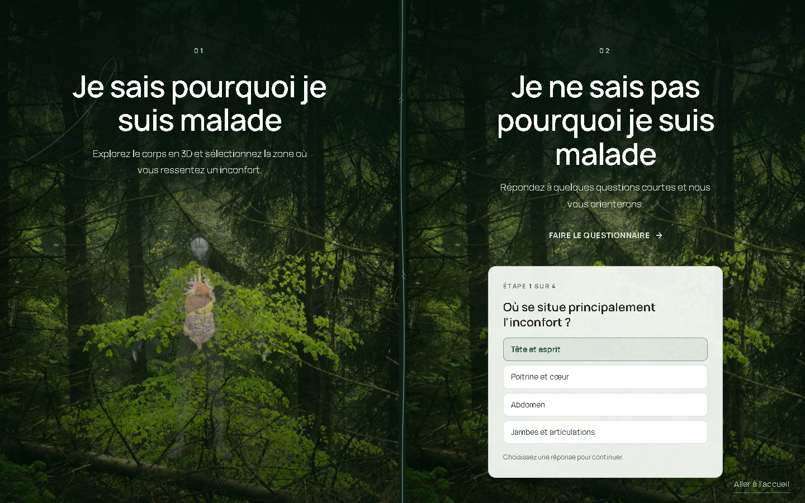</a> | `r20-04-start-quiz-hover.png` | `/start` | 1440×900 desktop | fr | "Je ne sais pourquoi je suis malade" — the questionnaire appears **in French**, rendered from the app's own strings, decorative (`aria-hidden`) so the panel stays a single button. |
| <a href="r20-25-start-tablet.png">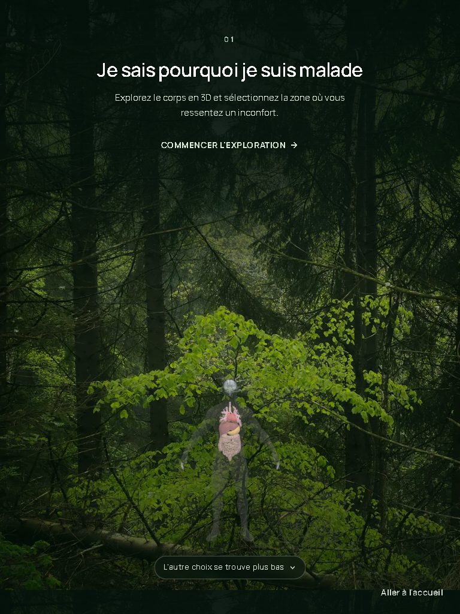</a> | `r20-25-start-tablet.png` | `/start` | 768×1024 tablet | fr | Stacked panels at tablet width — the framed preview window stays inside its own panel. |

## 3. Homepage

| Preview | File | Route | Viewport | Locale | What it shows |
| --- | --- | --- | --- | --- | --- |
| <a href="r20-05-home-chapter-1.png">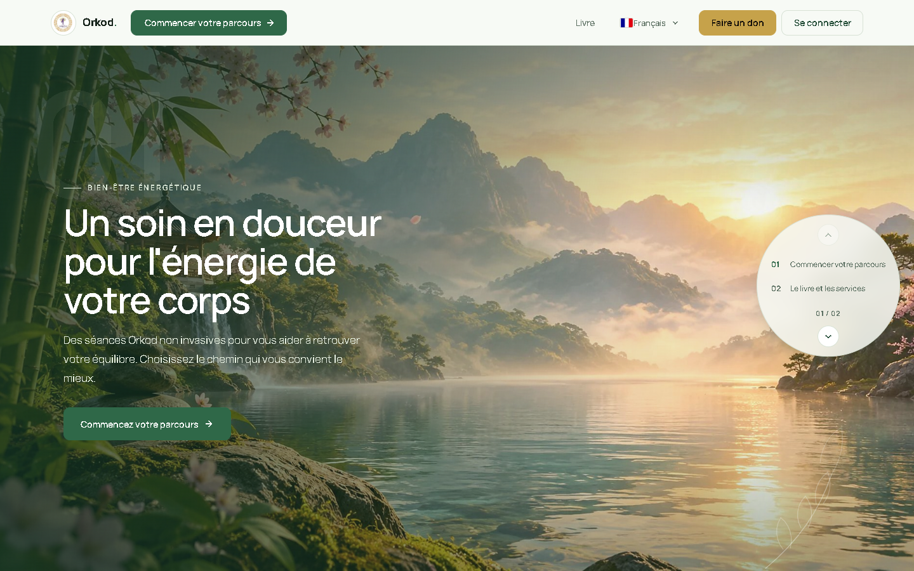</a> | `r20-05-home-chapter-1.png` | `/home` (chapter 01) | 1440×900 desktop | fr | Immersive nature hero, copy column, "Commencer votre parcours" CTA, chapter indicator 01 / 02. Unchanged by Round 20. |
| <a href="r20-06-home-chapter-2.png">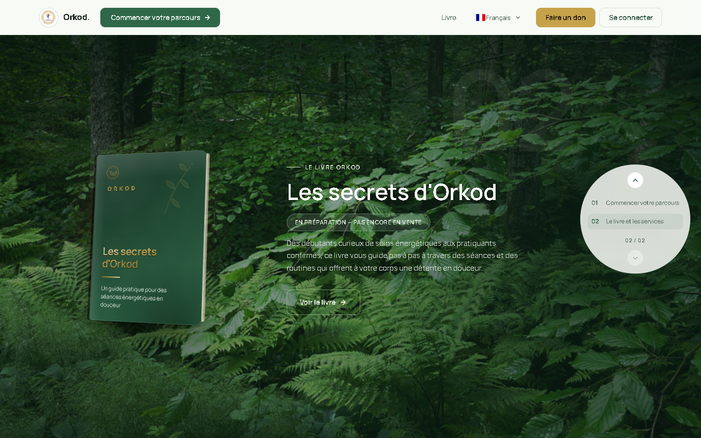</a> | `r20-06-home-chapter-2.png` | `/home` (chapter 02) | 1440×900 desktop | fr | Book section over the graded forest plate — the book object now carries the same **premium cover** as the book page (cloth board, foil title, emblem, sprig), with the sage status ribbon "En préparation — pas encore en vente" and the edge rail clear of the copy. |
| <a href="r20-08-mobile-home-390.png">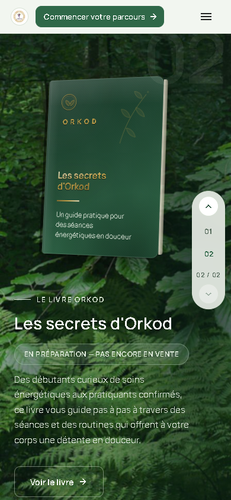</a> | `r20-08-mobile-home-390.png` | `/home` (chapter 02) | 390×844 mobile | fr | The chapter rail is a vertical edge rail (right in LTR); the book CTA and the copy are fully clear of it. |
| <a href="r20-08-mobile-home-360.png">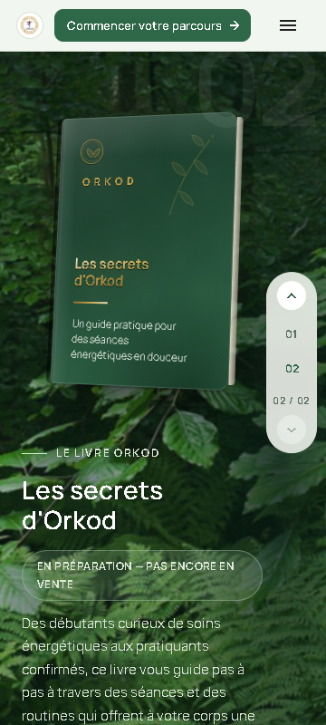</a> | `r20-08-mobile-home-360.png` | `/home` (chapter 02) | 360×800 mobile | fr | Same at the narrowest supported width — no collision, no horizontal overflow. |
| <a href="r20-08-mobile-home-768.png">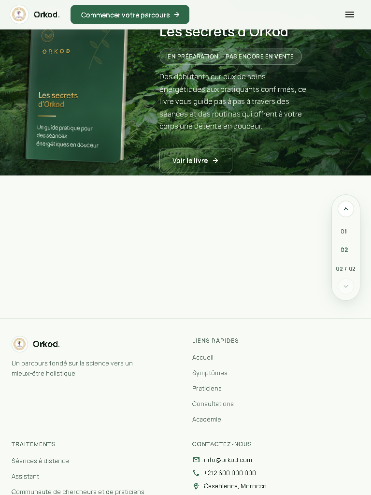</a> | `r20-08-mobile-home-768.png` | `/home` (chapter 02) | 768×1024 tablet | fr | Tablet width — the rail keeps its edge position, the CTA stays reachable. |
| <a href="r20-26-home-laptop-ch2.png">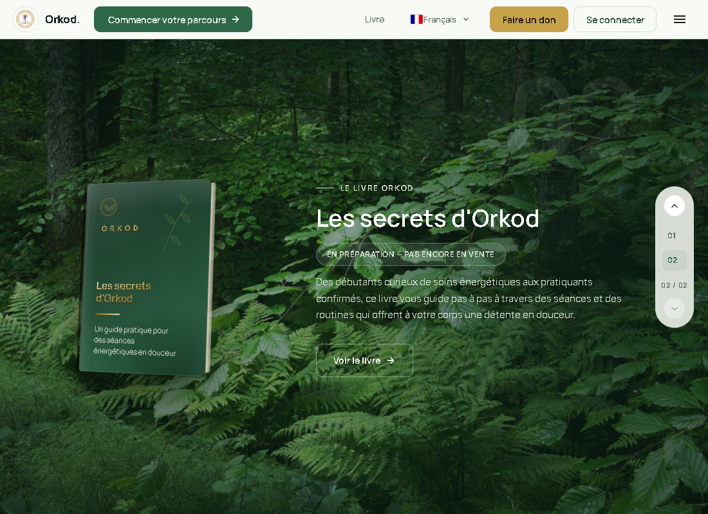</a> | `r20-26-home-laptop-ch2.png` | `/home` (chapter 02) | 1100×800 laptop | fr | Laptop width — the reserved rail strip keeps the book copy clear. |
| <a href="r20-07-header-desktop.png"></a> | `r20-07-header-desktop.png` | `/home` (header crop) | 1440×72 desktop | fr | Guest public header only — Orkod mark, nav entries, "Commencer votre parcours", "Faire un don", "Se connecter". |

## 4. Book page

| Preview | File | Route | Viewport | Locale | What it shows |
| --- | --- | --- | --- | --- | --- |
| <a href="r20-09-book.png">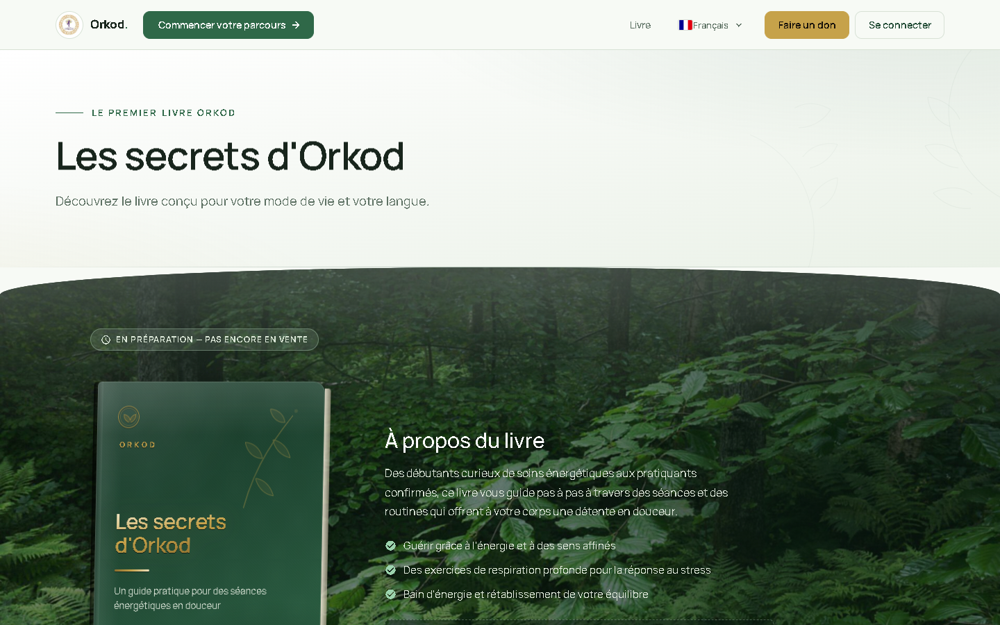</a> | `r20-09-book.png` | `/book` | 1440×900 desktop | fr | Concept spread — status ribbon first, then the **premium cover**: woven cloth board, gold-foil title, leaf emblem, botanical sprig, a "Couverture conceptuelle" label and the honest availability note. The pale page meets the forest through an arc and a mist. No price, no purchase. |
| <a href="r20-23-book-cover.png"></a> | `r20-23-book-cover.png` | `/book` | 1440×900 desktop | fr | The same page captured for the review — the cover object with its foil title, emblem and sprig, and the curved transition to the forest spread. |
| <a href="r20-17-mobile-book.png">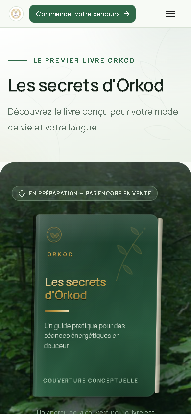</a> | `r20-17-mobile-book.png` | `/book` | 390×844 mobile | fr | Mobile order: status ribbon → cover → information. The honest state is read before the cover, and the cover never bleeds past the viewport. |

## 5. Body explorer

| Preview | File | Route | Viewport | Locale | What it shows |
| --- | --- | --- | --- | --- | --- |
| <a href="r20-10-body-default.png"></a> | `r20-10-body-default.png` | `/body` | 1440×900 desktop | fr | Default state — 3D body stage, seven-organ selector rail, and a neutral detail panel that offers the seven organs as a selection affordance. |
| <a href="r20-11-body-brain.png">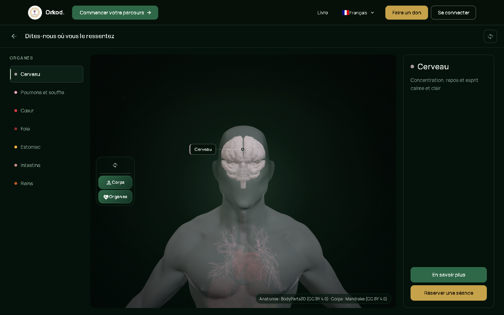</a> | `r20-11-body-brain.png` | `/body` | 1440×900 desktop | fr | "Cerveau" (brain) selected — the camera frames the head, the marker dot lands **inside the cranial cavity** on the brain itself, and the organ is revealed through a soft window in the shell instead of being hidden behind a flat haze. |
| <a href="r20-21-body-brain.png"></a> | `r20-21-body-brain.png` | `/body` | 1440×900 desktop | fr | The same brain focus captured for the review — the head band carries real structure (standard deviation 56.3, 12,791 lit pixels) where the Round 19 capture was flat (standard deviation 27.6 over a uniform band). |
| <a href="r20-15-body-mobile.png"></a> | `r20-15-body-mobile.png` | `/body` | 390×844 mobile | fr | Mobile body explorer — stacked organ selectors, no horizontal overflow. |
| <a href="r20-22-mobile-body.png">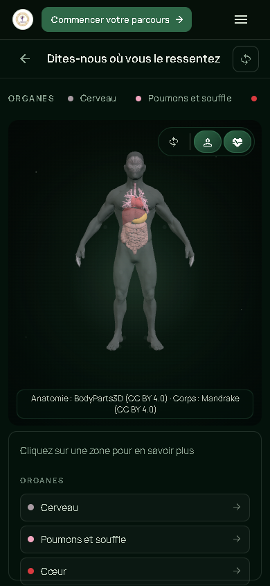</a> | `r20-22-mobile-body.png` | `/body` | 390×844 mobile | fr | The model credit is now a **caption strip under the figure** — it no longer floats over the anatomy, and the detail panel starts below the stage. |
| <a href="r20-28-body-mobile-360.png">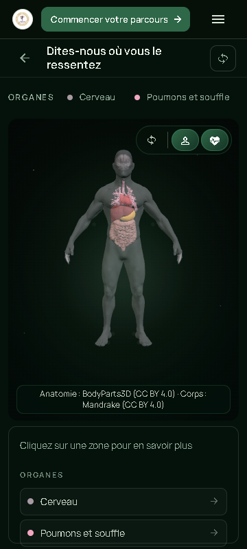</a> | `r20-28-body-mobile-360.png` | `/body` | 360×800 mobile | fr | The narrowest supported width — the same clean stack, no overlap at any width. |

## 6. Donations

| Preview | File | Route | Viewport | Locale | What it shows |
| --- | --- | --- | --- | --- | --- |
| <a href="r20-18-mobile-donations.png"></a> | `r20-18-mobile-donations.png` | `/donations` | 390×844 mobile | fr | Mobile donations page — unchanged by Round 20, kept as a regression reference. |

## 7. Arabic / RTL

| Preview | File | Route | Viewport | Locale | What it shows |
| --- | --- | --- | --- | --- | --- |
| <a href="r20-12-home-arabic.png">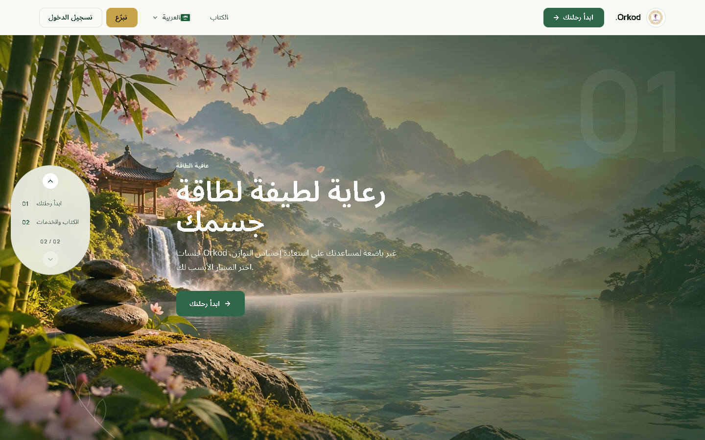</a> | `r20-12-home-arabic.png` | `/home` (chapter 01) | 1440×900 desktop | ar (`dir=rtl`) | Homepage in Arabic — RTL mirroring, Arabic display font, translated hero copy. |
| <a href="r20-24-book-arabic.png">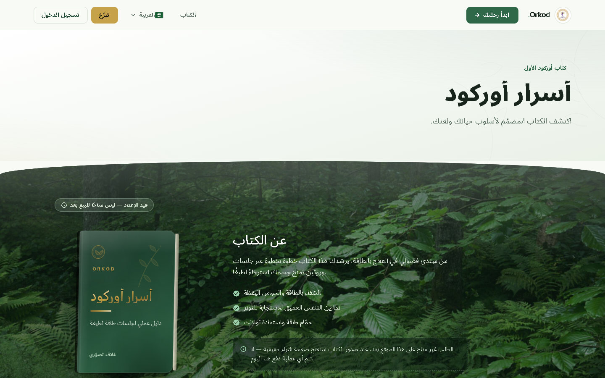</a> | `r20-24-book-arabic.png` | `/book` | 1440×900 desktop | ar (`dir=rtl`) | Book page in Arabic — the new cover and the status ribbon mirror correctly. |
| <a href="r20-27-body-brain-arabic.png">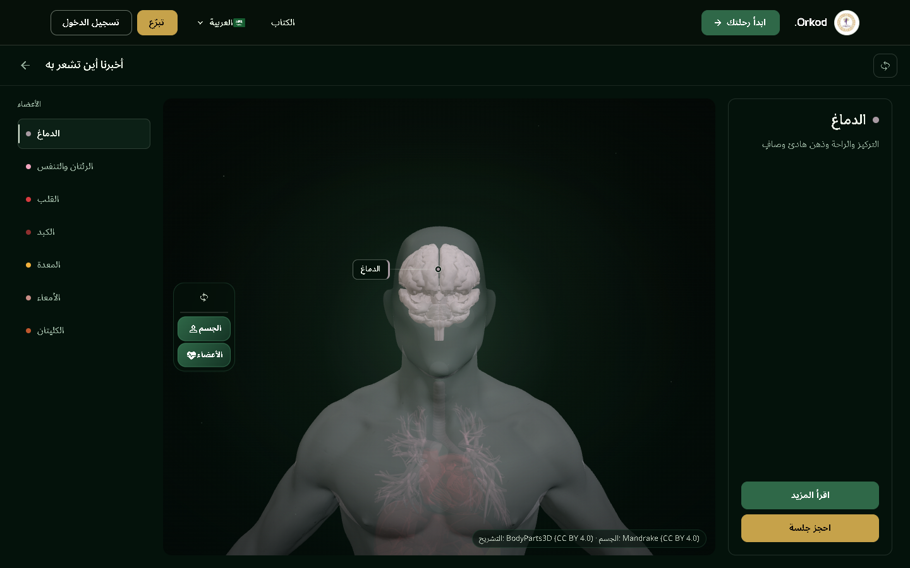</a> | `r20-27-body-brain-arabic.png` | `/body` | 1440×900 desktop | ar (`dir=rtl`) | Body explorer with the brain selected in Arabic — the 3D anatomy is **not** mirrored. |

## 8. Mobile (390×844)

| Preview | File | Route | Viewport | Locale | What it shows |
| --- | --- | --- | --- | --- | --- |
| <a href="r20-13-mobile-start.png">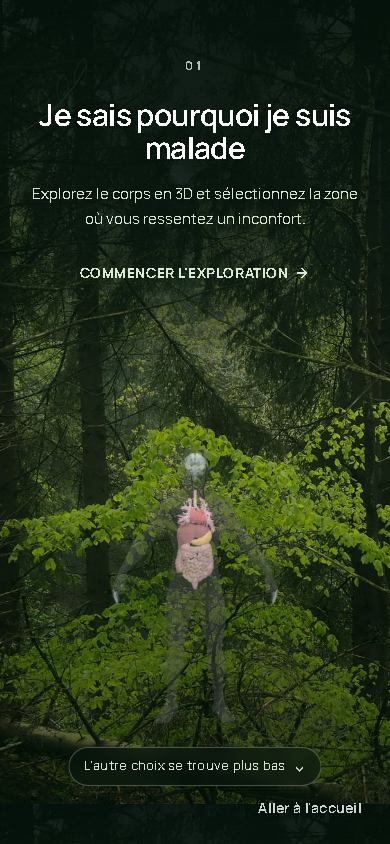</a> | `r20-13-mobile-start.png` | `/start` | 390×844 mobile | fr | First choice on a phone — copy on top, the framed anatomy window anchored at the foot of its own panel, and the quiet "L'autre choix se trouve plus bas" hint. Natural scrolling, no site header. |
| <a href="r20-19-mobile-start.png"></a> | `r20-19-mobile-start.png` | `/start` | 390×844 mobile | fr | The second choice — the questionnaire card in French, fully readable, with the skip link clear of the content. |
| <a href="r20-29-mobile-start-quiz.png"></a> | `r20-29-mobile-start-quiz.png` | `/start` (scrolled to the card) | 390×844 mobile | fr | The questionnaire **in the flow**: the card sits below the copy instead of over it, and nothing is covered (0 px² of overlap with the heading, the copy or the call to action). |
| <a href="r20-14-mobile-start-bottom.png">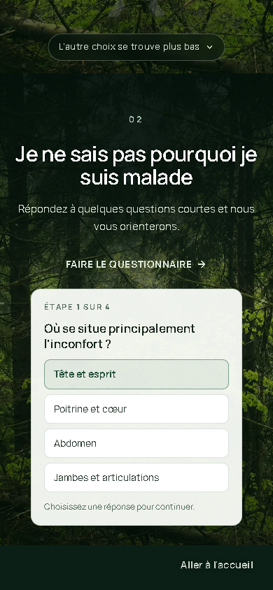</a> | `r20-14-mobile-start-bottom.png` | `/start` (scrolled) | 390×844 mobile | fr | The bottom of the same page — the skip link clear of the content. |
| <a href="r20-16-mobile-home.png">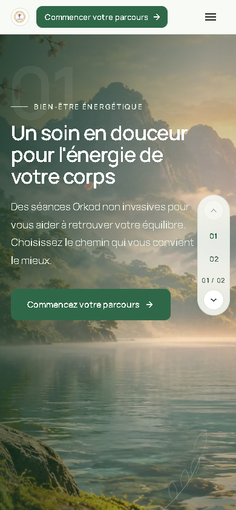</a> | `r20-16-mobile-home.png` | `/home` | 390×844 mobile | fr | Mobile homepage, chapter 01. |

## 9. Supporting files

| File | What it is |
| --- | --- |
| [`contact-sheet.png`](contact-sheet.png) | 1728×2716 contact sheet of all 29 screenshots, captioned. |
| [`verification-report.txt`](verification-report.txt) | Raw log of the Round 20 harness run: 17 groups, 17 passed / 0 failed, with the measured values. |

---

## Full-resolution raw URLs

Every file is also reachable directly (useful for image-capable tooling):

```
https://raw.githubusercontent.com/rezoroyone-dev/orkod-review/visual-review/nature-green-round-20/screenshots/nature-green-round-20/<file>
```

| File | Raw URL |
| --- | --- |
| `r20-01-language-gate.png` | https://raw.githubusercontent.com/rezoroyone-dev/orkod-review/visual-review/nature-green-round-20/screenshots/nature-green-round-20/r20-01-language-gate.png |
| `r20-02-start-neutral.png` | https://raw.githubusercontent.com/rezoroyone-dev/orkod-review/visual-review/nature-green-round-20/screenshots/nature-green-round-20/r20-02-start-neutral.png |
| `r20-03-start-body-hover.png` | https://raw.githubusercontent.com/rezoroyone-dev/orkod-review/visual-review/nature-green-round-20/screenshots/nature-green-round-20/r20-03-start-body-hover.png |
| `r20-04-start-quiz-hover.png` | https://raw.githubusercontent.com/rezoroyone-dev/orkod-review/visual-review/nature-green-round-20/screenshots/nature-green-round-20/r20-04-start-quiz-hover.png |
| `r20-05-home-chapter-1.png` | https://raw.githubusercontent.com/rezoroyone-dev/orkod-review/visual-review/nature-green-round-20/screenshots/nature-green-round-20/r20-05-home-chapter-1.png |
| `r20-06-home-chapter-2.png` | https://raw.githubusercontent.com/rezoroyone-dev/orkod-review/visual-review/nature-green-round-20/screenshots/nature-green-round-20/r20-06-home-chapter-2.png |
| `r20-07-header-desktop.png` | https://raw.githubusercontent.com/rezoroyone-dev/orkod-review/visual-review/nature-green-round-20/screenshots/nature-green-round-20/r20-07-header-desktop.png |
| `r20-08-mobile-home-360.png` | https://raw.githubusercontent.com/rezoroyone-dev/orkod-review/visual-review/nature-green-round-20/screenshots/nature-green-round-20/r20-08-mobile-home-360.png |
| `r20-08-mobile-home-390.png` | https://raw.githubusercontent.com/rezoroyone-dev/orkod-review/visual-review/nature-green-round-20/screenshots/nature-green-round-20/r20-08-mobile-home-390.png |
| `r20-08-mobile-home-768.png` | https://raw.githubusercontent.com/rezoroyone-dev/orkod-review/visual-review/nature-green-round-20/screenshots/nature-green-round-20/r20-08-mobile-home-768.png |
| `r20-09-book.png` | https://raw.githubusercontent.com/rezoroyone-dev/orkod-review/visual-review/nature-green-round-20/screenshots/nature-green-round-20/r20-09-book.png |
| `r20-10-body-default.png` | https://raw.githubusercontent.com/rezoroyone-dev/orkod-review/visual-review/nature-green-round-20/screenshots/nature-green-round-20/r20-10-body-default.png |
| `r20-11-body-brain.png` | https://raw.githubusercontent.com/rezoroyone-dev/orkod-review/visual-review/nature-green-round-20/screenshots/nature-green-round-20/r20-11-body-brain.png |
| `r20-12-home-arabic.png` | https://raw.githubusercontent.com/rezoroyone-dev/orkod-review/visual-review/nature-green-round-20/screenshots/nature-green-round-20/r20-12-home-arabic.png |
| `r20-13-mobile-start.png` | https://raw.githubusercontent.com/rezoroyone-dev/orkod-review/visual-review/nature-green-round-20/screenshots/nature-green-round-20/r20-13-mobile-start.png |
| `r20-14-mobile-start-bottom.png` | https://raw.githubusercontent.com/rezoroyone-dev/orkod-review/visual-review/nature-green-round-20/screenshots/nature-green-round-20/r20-14-mobile-start-bottom.png |
| `r20-15-body-mobile.png` | https://raw.githubusercontent.com/rezoroyone-dev/orkod-review/visual-review/nature-green-round-20/screenshots/nature-green-round-20/r20-15-body-mobile.png |
| `r20-16-mobile-home.png` | https://raw.githubusercontent.com/rezoroyone-dev/orkod-review/visual-review/nature-green-round-20/screenshots/nature-green-round-20/r20-16-mobile-home.png |
| `r20-17-mobile-book.png` | https://raw.githubusercontent.com/rezoroyone-dev/orkod-review/visual-review/nature-green-round-20/screenshots/nature-green-round-20/r20-17-mobile-book.png |
| `r20-18-mobile-donations.png` | https://raw.githubusercontent.com/rezoroyone-dev/orkod-review/visual-review/nature-green-round-20/screenshots/nature-green-round-20/r20-18-mobile-donations.png |
| `r20-19-mobile-start.png` | https://raw.githubusercontent.com/rezoroyone-dev/orkod-review/visual-review/nature-green-round-20/screenshots/nature-green-round-20/r20-19-mobile-start.png |
| `r20-20-start-body-preview.png` | https://raw.githubusercontent.com/rezoroyone-dev/orkod-review/visual-review/nature-green-round-20/screenshots/nature-green-round-20/r20-20-start-body-preview.png |
| `r20-21-body-brain.png` | https://raw.githubusercontent.com/rezoroyone-dev/orkod-review/visual-review/nature-green-round-20/screenshots/nature-green-round-20/r20-21-body-brain.png |
| `r20-22-mobile-body.png` | https://raw.githubusercontent.com/rezoroyone-dev/orkod-review/visual-review/nature-green-round-20/screenshots/nature-green-round-20/r20-22-mobile-body.png |
| `r20-23-book-cover.png` | https://raw.githubusercontent.com/rezoroyone-dev/orkod-review/visual-review/nature-green-round-20/screenshots/nature-green-round-20/r20-23-book-cover.png |
| `r20-24-book-arabic.png` | https://raw.githubusercontent.com/rezoroyone-dev/orkod-review/visual-review/nature-green-round-20/screenshots/nature-green-round-20/r20-24-book-arabic.png |
| `r20-25-start-tablet.png` | https://raw.githubusercontent.com/rezoroyone-dev/orkod-review/visual-review/nature-green-round-20/screenshots/nature-green-round-20/r20-25-start-tablet.png |
| `r20-26-home-laptop-ch2.png` | https://raw.githubusercontent.com/rezoroyone-dev/orkod-review/visual-review/nature-green-round-20/screenshots/nature-green-round-20/r20-26-home-laptop-ch2.png |
| `r20-27-body-brain-arabic.png` | https://raw.githubusercontent.com/rezoroyone-dev/orkod-review/visual-review/nature-green-round-20/screenshots/nature-green-round-20/r20-27-body-brain-arabic.png |
| `r20-28-body-mobile-360.png` | https://raw.githubusercontent.com/rezoroyone-dev/orkod-review/visual-review/nature-green-round-20/screenshots/nature-green-round-20/r20-28-body-mobile-360.png |
| `r20-29-mobile-start-quiz.png` | https://raw.githubusercontent.com/rezoroyone-dev/orkod-review/visual-review/nature-green-round-20/screenshots/nature-green-round-20/r20-29-mobile-start-quiz.png |
| `contact-sheet.png` | https://raw.githubusercontent.com/rezoroyone-dev/orkod-review/visual-review/nature-green-round-20/screenshots/nature-green-round-20/contact-sheet.png |
| `verification-report.txt` | https://raw.githubusercontent.com/rezoroyone-dev/orkod-review/visual-review/nature-green-round-20/screenshots/nature-green-round-20/verification-report.txt |
