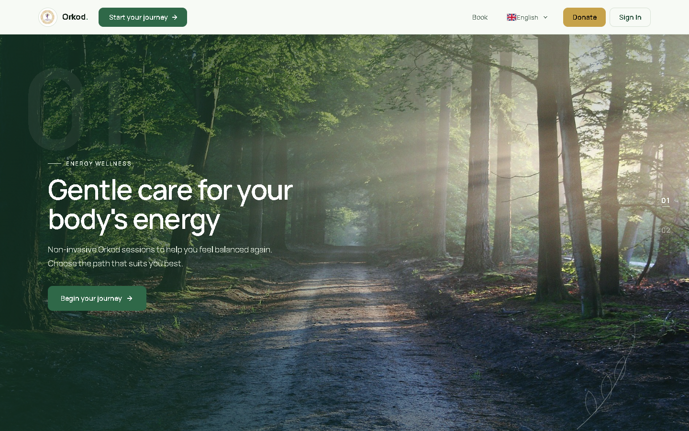
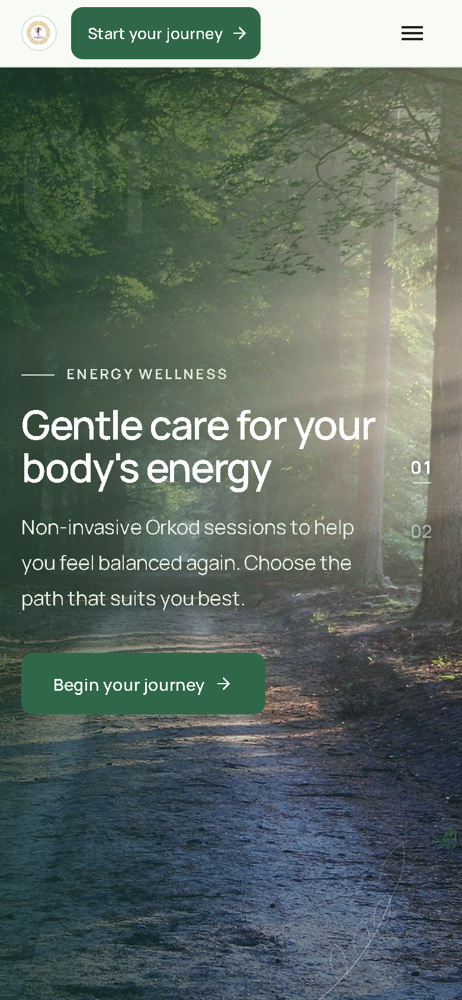
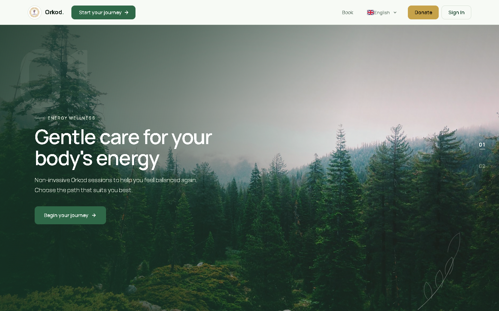
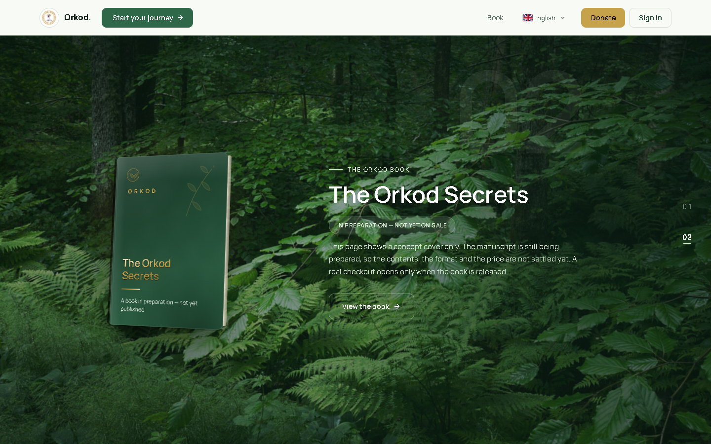
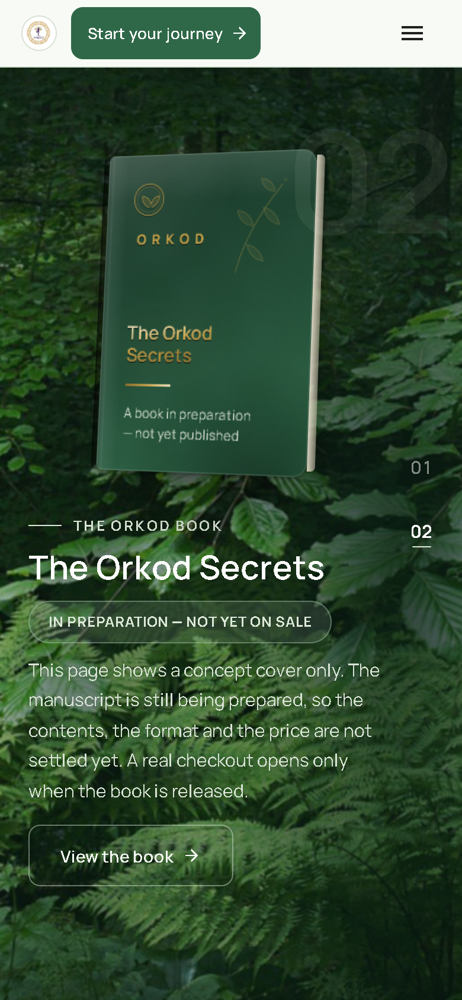
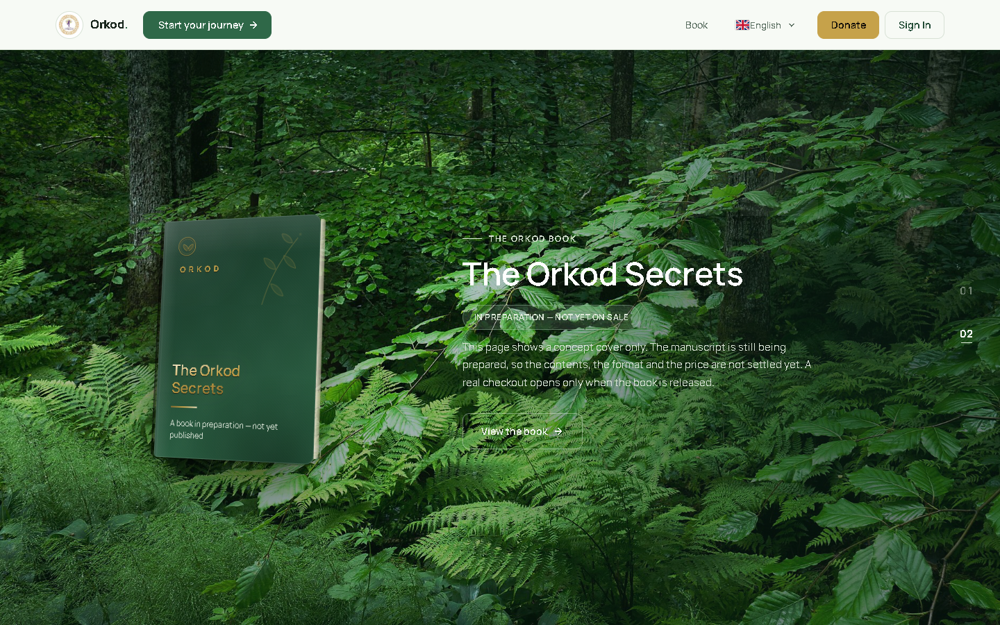
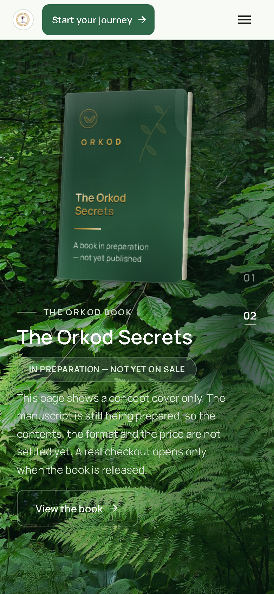

# Nature Green — Round 28 · Homepage imagery A/B comparison

Branch `visual-review/nature-green-round-28`. **This round is comparison-only: no shipped asset
has been overwritten and no application file is changed by this branch.** The purpose of this
branch is to let a reviewer inspect the actual homepage render with each hero candidate and the
re-graded Section 02 plate before a final selection is made.

Everything below is a **real screenshot of the running site** (`https://localhost/home`, English,
`localStorage['orkod.locale']='en'`). For each candidate the hero image file requested by the page
(`/images/nature/home-forest.jpg` and `/images/nature/home-forest-mobile.jpg`) was intercepted and
replaced with the candidate file, so **layout, typography, copy, geometry and text placement are
byte-for-byte identical to the shipped page** — only the photograph differs. Measured proof of that
is in the "Layout is unchanged" section.

---

## 1. Section 01 hero — three-way comparison

All six images are the same viewport (`1440×900` desktop, `390×844` mobile), same locale, same copy.

### Baseline — current first-party photo (unrecorded provenance)

| Desktop 1440×900 | Mobile 390×844 |
| --- | --- |
|  |  |

Direct links:
[desktop](hero/hero-baseline-desktop.png) ·
[mobile](hero/hero-baseline-mobile.png)

This is the asset shipped today: `home-forest.jpg` / `home-forest-mobile.jpg`, derived from the
project's own reference photograph whose upstream provenance was never recorded
(`public/images/nature/ASSETS.md`, "First-party assets (pre-Round 19)"). Measured mean luminance
**154**; it is bright, but the licence provenance is the weak point.

### Candidate A — "The Road", bertvthul, CC0

| Desktop 1440×900 | Mobile 390×844 |
| --- | --- |
|  |  |

Direct links:
[desktop](hero/hero-a-road-desktop.png) ·
[mobile](hero/hero-a-road-mobile.png)

Source file (the graded plate the page served):
[desktop plate](candidates/hero-a-the-road-desktop-1920x1080.jpg) ·
[mobile plate](candidates/hero-a-the-road-mobile-1080x1620.jpg)

- **Source:** [File:The Road - Seems like it's the way to the heaven on earth.jpg](https://commons.wikimedia.org/wiki/File:The_Road_-_Seems_like_it%27s_the_way_to_the_heaven_on_earth.jpg)
- **Author:** bertvthul
- **Licence:** CC0 1.0 Universal (public domain dedication) — verified via the Commons API
  `extmetadata` (`LicenseShortName = CC0`, `UsageTerms = Creative Commons Zero, Public Domain Dedication`).
- **Original size:** 1920×1280.
- **Why it fits:** it is a genuine, unfiltered photograph of a forest trail with real depth (a lit
  path receding into the trees). Its left third measures luminance **64** against a centre of
  **117**, so hero copy sits on calm, dark foliage while the open path stays bright — legible text
  without darkening the whole frame. Natural saturation **0.30** (not the oversaturated look of
  some "cinematic" CC0 plates).
- **Processing:** gentle shadow-green tint, +6% contrast, +4% saturation, +2% brightness, mild
  vignette, unsharp mask. **No blur, no heavy darkening.**

### Candidate B — "Fog descending on a pine forest", Unsplash (CC0)

| Desktop 1440×900 | Mobile 390×844 |
| --- | --- |
|  |  |

Direct links:
[desktop](hero/hero-b-fog-desktop.png) ·
[mobile](hero/hero-b-fog-mobile.png)

Source file (the graded plate the page served):
[desktop plate](candidates/hero-b-fog-pines-desktop-1920x1080.jpg) ·
[mobile plate](candidates/hero-b-fog-pines-mobile-1080x1620.jpg)

- **Source:** [File:Fog descending on a pine forest (Unsplash).jpg](https://commons.wikimedia.org/wiki/File:Fog_descending_on_a_pine_forest_(Unsplash).jpg)
- **Author:** Unsplash (CC0 release, imported to Commons).
- **Licence:** CC0 1.0 Universal — verified via the Commons API `extmetadata`.
- **Original size:** 3264×2448.
- **Look:** misty, atmospheric, muted greens; mean luminance **122**, saturation **0.23**. Very
  authentic and calm, but the pale fog gives lower copy contrast, so it leans on the top veil more.
- **Processing:** as Candidate A, with a slightly gentler vignette and no warm tint.

---

## 2. Section 02 — the book backdrop, before/after

Same page, scrolled to chapter 02, same copy and book design. Only the background photograph differs.

| | Desktop 1440×900 | Mobile 390×844 |
| --- | --- | --- |
| **Baseline (Round-19 grade: mean lum 74, clipped highlights, 1.1px blur)** |  |  |
| **Candidate (natural brightness, highlights restored, no blur)** |  |  |

Direct links:
[baseline desktop](section02/section02-baseline-desktop.png) ·
[baseline mobile](section02/section02-baseline-mobile.png) ·
[candidate desktop](section02/section02-noblur-desktop.png) ·
[candidate mobile](section02/section02-noblur-mobile.png) ·
[candidate plate](candidates/section02-beech-noblur-1920x1080.jpg)

- **Source:** [File:Beech and ferns in Gullmarsskogen.jpg](https://commons.wikimedia.org/wiki/File:Beech_and_ferns_in_Gullmarsskogen.jpg)
- **Author:** W.carter
- **Licence:** CC0 1.0 Universal — verified via the Commons API `extmetadata`. **The same documented
  source already shipped today**; only the processing changes.
- **Baseline processing (what is live now):** shadow-green 0.30, −20% brightness, saturation 0.88,
  vignette 0.32, **then a 1.1px Gaussian blur**. Measured: mean luminance **74**, highlights clipped
  to a max of **220**, saturation 0.45.
- **Candidate processing:** shadow-green 0.16, +6% brightness, contrast 1.10, saturation 1.02,
  vignette 0.20, unsharp mask, **no blur**. Measured: mean luminance **95**, highlight max restored
  to **255**, saturation 0.57, green dominance +47 (lush, alive).
- **Readability:** kept by the existing **localized** `radial-gradient` veils behind the copy and
  the book stage (unchanged CSS), not by darkening the whole plate.

---

## 3. Layout is unchanged (measured)

For the hero, the copy geometry was captured in each render and is identical across baseline /
A / B — confirming only the photograph was swapped:

| Variant | `h1` box (desktop) | `lead` box (desktop) | `object-position` |
| --- | --- | --- | --- |
| baseline | x100 y365 w560 h122 | x100 y506 w480 h60 | 62% 50% |
| A (road) | x100 y365 w560 h122 | x100 y506 w480 h60 | 62% 50% |
| B (fog) | x100 y365 w560 h122 | x100 y506 w480 h60 | 62% 50% |

Mobile is identical too (`h1` x18 y340 w310 h72; `lead` x18 y430 w310 h89; `object-position`
68% 50%). The `naturalWidth/Height` reported by the page matches each candidate
(1920×1080 desktop / 1080×1620 mobile), proving the served plate is the candidate, not the old file.

For Section 02 the CSS `filter` on the background is identical in both renders
(`saturate(1.08) contrast(1.05) brightness(0.96)`), so the visible difference is entirely the
re-processed file.

---

## 4. Licence verification (Commons API)

| Candidate | Commons title | `LicenseShortName` | `UsageTerms` | Author |
| --- | --- | --- | --- | --- |
| A | The Road - Seems like it's the way to the heaven on earth.jpg | CC0 | Creative Commons Zero, Public Domain Dedication | bertvthul |
| B | Fog descending on a pine forest (Unsplash).jpg | CC0 | Creative Commons Zero, Public Domain Dedication | Unsplash |
| Section 02 | Beech and ferns in Gullmarsskogen.jpg | CC0 | Creative Commons Zero, Public Domain Dedication | W.carter |

Machine-readable source list for the candidate pipeline:
`frontend/scripts/gen/art_direct_round28_candidates.py`. Nothing in this round is AI-generated and
no paid asset is used.

---

## 5. Status — what is final and what is not

- **Not final.** No `public/images/nature/*` file has been overwritten; the app still serves the
  current assets. This branch contains only screenshots and candidate plates for review.
- **Not published as app code.** No application source, no backend, no database change.
- On selection, the chosen plate(s) will be regenerated into
  `frontend/public/images/nature/`, the Section 02 grade applied to `ch2-forest.jpg`, and
  `ASSETS.md` / `SOURCES.json` updated with the new entries.

### SHA-256 (first 16 hex) of every image on this page

```
F74C864E8147E5D0  candidates/hero-a-the-road-desktop-1920x1080.jpg
0135C732407E3387  candidates/hero-a-the-road-mobile-1080x1620.jpg
0F7992155A05AC1C  candidates/hero-b-fog-pines-desktop-1920x1080.jpg
3E88E53C10355580  candidates/hero-b-fog-pines-mobile-1080x1620.jpg
CA5CC28BFDE3E63C  candidates/section02-beech-noblur-1920x1080.jpg
2B2EA06F857F7FE9  hero/hero-a-road-desktop.png
25C60F2806D61E68  hero/hero-a-road-mobile.png
9B83FBE71A249B8C  hero/hero-b-fog-desktop.png
FFEA306D3998022B  hero/hero-b-fog-mobile.png
6FDA2E107DDCE013  hero/hero-baseline-desktop.png
08F0F6A014C73E29  hero/hero-baseline-mobile.png
38A6ACE87B66E3A3  section02/section02-baseline-desktop.png
51173855074FCBB7  section02/section02-baseline-mobile.png
F911722E690E2BB3  section02/section02-noblur-desktop.png
68E32E024800D860  section02/section02-noblur-mobile.png
```
